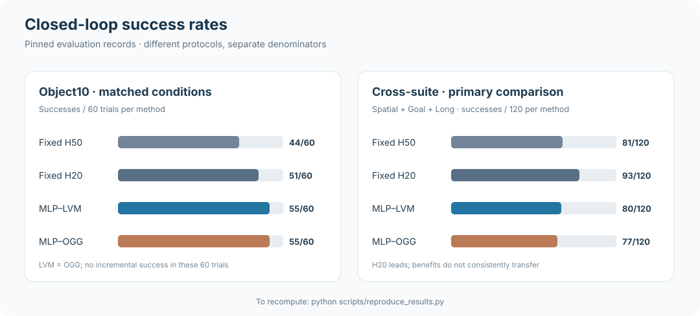
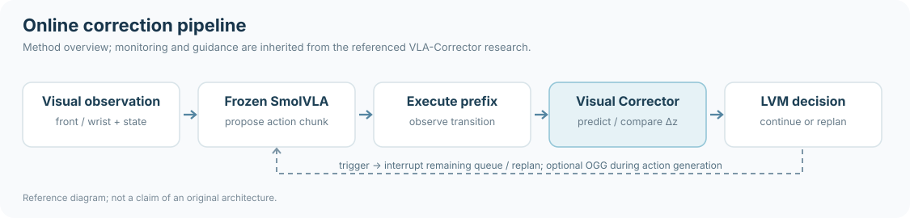

# SmolVLA-Corrector

  <a href="README.md">简体中文</a> · <strong>English</strong>

**Reproduction and empirical study of VLA-Corrector with SmolVLA and LIBERO**

An independent research implementation based on [VLA-Corrector](https://github.com/ZJU-OmniAI/vla-corrector) (NeurIPS 2026). This repository preserves selected predictor-training and online-correction code, alongside recorded closed-loop evidence. It is not the official implementation, and its results are not the original paper's headline benchmark.

[Technical report](docs/TECHNICAL_REPORT.en.md) · [Code map](docs/CODE_MAP.md) · [Reproduction guide](docs/REPRODUCTION.md) · [Source attribution](THIRD_PARTY.md)

## Research question

A VLA policy can emit a long action chunk, but subsequent environment observations can diverge from its expected visual transition. This study tests whether an action-conditioned visual dynamics predictor and event-triggered replanning improve execution while controlling the cost of frequent VLA calls.

## Main observations

| Strategy | Object10 (60 matched trials) | Spatial + Goal + Long (120 primary trials) |
| --- | ---: | ---: |
| Fixed H50 | 44/60 | 81/120 |
| Fixed H20 | 51/60 | **93/120** |
| MLP + LVM | **55/60** | 80/120 |
| MLP + OGG | **55/60** | 77/120 |

**Interpretation.** Event-triggered LVM improves the Object10 outcome under this protocol, but does not retain an advantage on the independent suite comparisons. OGG provides no additional Object10 success-rate improvement beyond LVM. Monitoring also adds wall-clock overhead, even if it can reduce the number of VLA chunk generations.

The broader experiment record includes 5 predictor configurations × 3 training seeds, 1,200 formal configuration/method trials on Object10, and 880 completed cross-suite trials in 220 four-method matched groups. Reused baseline trials are not independent observations.

For execution-window sensitivity, see the [32-condition LIBERO-Plus study](results/plus_horizon/summary.json). A shorter executed prefix is not uniformly better.

## Code and evidence

| Path | Contents |
| --- | --- |
| [implementation/](implementation/) | Pinned predictor/data/training, online LVM/OGG and LIBERO simulation scripts |
| [results/object10/](results/object10/) | Training runs, matched method comparisons and monitor coverage |
| [results/cross_suite/](results/cross_suite/) | Full 880-trial ledger and primary suite aggregates |
| [results/plus_horizon/](results/plus_horizon/) | Five fixed execution horizons on selected LIBERO-Plus conditions |
| [provenance/source_map.json](provenance/source_map.json) | Exact upstream repository, commit, source file and Git blob SHA for each imported artifact |

The code is a **curated frozen research integration**, not a standalone GPU package; the original run environment and external checkpoints remain separate. See the [reproduction guide](docs/REPRODUCTION.md) before trying GPU training or simulation.

## Check the published numbers

Python 3.10+; standard library only, no downloads or GPU required:

~~~bash
python scripts/check_source_integrity.py
python scripts/reproduce_results.py --format markdown
python -m unittest discover -s tests -v
~~~

The first command checks committed file digests and documented CSV line-ending normalization; the second recomputes the public tables, including the four-method cross-suite trial ledger.

## Reading notes

- [Technical report](docs/TECHNICAL_REPORT.en.md) — method details, controlled comparisons and limitations. **Working draft: author sections are explicitly marked for completion.**
- [Reproduction guide](docs/REPRODUCTION.md) — scope, dependencies, source versions and known gaps.
- [Third-party credits](THIRD_PARTY.md) — original paper, dependencies and redistributed-code attribution.

**Scope limits.** The main cross-suite table excludes extra-initial-state runs and the fixed LIBERO-90 subset; the base SmolVLA policy's full task-level training coverage is not established. Selected comparison cases should not be treated as unbiased aggregate performance.

> **Portfolio work in progress:** The public quantitative results and frozen source files are real and provenance-pinned. Original case videos, fresh-clone GPU verification and the author's detailed interpretation remain to be added.

---

**Documentation:** The Chinese [README](README.md) and [technical report](docs/TECHNICAL_REPORT.md) are the primary editable versions. This English translation is synchronized from Chinese; published numbers must always be checked against the original evidence.
