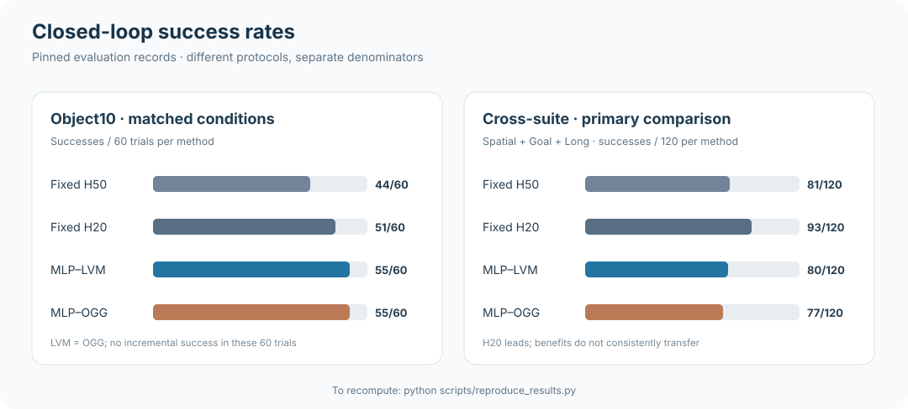
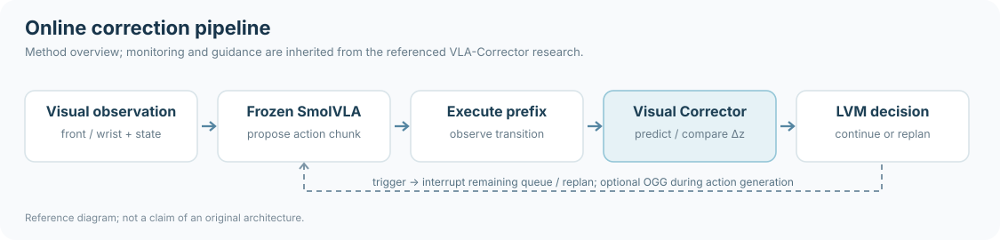

# SmolVLA-Corrector

**基于 VLA-Corrector 的复现、扩展与闭环鲁棒性研究**

  <strong>简体中文</strong> · <a href="README.en.md">English</a>

本项目以 [VLA-Corrector](https://github.com/ZJU-OmniAI/vla-corrector)（NeurIPS 2026）为基础，结合 **SmolVLA / LIBERO**，研究视觉动态预测、在线状态偏离监测与事件触发重规划在机器人操作任务中的实际效果。仓库整理了历史训练与在线执行代码、可复算的实验记录，以及复现过程中发现的局限。

**本仓库是独立复现与实证研究，不是原论文官方实现；下文成绩也不是原论文公布的基准结果。**

[技术报告（中文）](docs/TECHNICAL_REPORT.md) · [代码说明](docs/CODE_MAP.md) · [复现说明](docs/REPRODUCTION.md) · [第三方来源与许可](THIRD_PARTY.md)

## 研究问题

VLA通常一次生成一段动作（Action Chunk）。在执行过程中，环境状态可能偏离生成动作时的预期；始终执行完整动作块难以及时利用新观测，但频繁重新调用VLA也有计算成本。

本项目研究：**能否利用视觉特征变化预测判断何时需要重新规划？这种机制在闭环成功率、计算开销和跨任务迁移上是否真正有效？**

## 主要实验结果

| 方法 | Object10（60组配对回合/方法） | Spatial + Goal + Long（主要比较：120回合/方法） |
| --- | ---: | ---: |
| 固定执行 H50 | 44/60 | 81/120 |
| 固定执行 H20 | 51/60 | **93/120** |
| MLP + LVM | **55/60** | 80/120 |
| MLP + OGG | **55/60** | 77/120 |

在Object10的配对测试中，MLP-LVM的成功回合数高于固定H20与H50，但**OGG相较LVM没有增加成功回合**。在Spatial、Goal、Long三个任务套件的预先固定主要比较中，H20反而领先。监测能够改变VLA生成动作块的次数，但会引入额外的墙钟耗时；不能仅凭动作块调用次数声称端到端加速。

完整实验记录包括 **5种预测器配置×3个训练种子**、Object10的 **1,200个配置/方法级正式评测回合**，以及跨任务的 **880个正式回合（220组四方法配对）**。不同预测器配置下重复执行的基线，不能累计为独立样本。

此外，另有[LIBERO-Plus上32个条件的执行窗口实验](results/plus_horizon/summary.json)：执行窗口缩短并不必然改善成功率。

## 代码与实验记录

| 路径 | 内容 |
| --- | --- |
| [implementation/](implementation/) | 固定版本预测器、训练、LVM/OGG与LIBERO集成源码 |
| [results/object10/](results/object10/) | 训练结果、配对对照、监测覆盖率 |
| [results/cross_suite/](results/cross_suite/) | 880条跨任务回合记录及汇总 |
| [results/plus_horizon/](results/plus_horizon/) | LIBERO-Plus执行窗口实验 |
| [provenance/source_map.json](provenance/source_map.json) | 每份迁移文件的原仓库、固定提交、路径和Git Blob SHA |

这些代码保留了研究时的集成方式，**并不是已经通过全新环境一键GPU复现的独立软件包**。不同实验的历史Checkpoint需要对应的冻结源码，见[复现说明](docs/REPRODUCTION.md)。

## 复算公开数据

只需要Python 3.10+标准库，无需GPU、模型下载或仿真：

~~~bash
python scripts/check_source_integrity.py
python scripts/reproduce_results.py --format markdown
python -m unittest discover -s tests -v
~~~

三条命令分别用于检查迁移文件来源、复算实验统计和运行CPU回归测试。

## 阅读与后续完善

先阅读本页及[技术报告](docs/TECHNICAL_REPORT.md)理解方法和实验边界；查看实现时参考[代码索引](docs/CODE_MAP.md)和[来源映射](provenance/source_map.json)。

**研究边界：** 跨任务主表不包含补充初始状态及固定LIBERO-90十任务子集；基础SmolVLA的任务级训练覆盖尚未独立核对。后续发布的精选视频只用于解释具体案例，不能替代整体统计。

> **当前状态：** 代码与公开实验记录已整理，技术报告仍有作者待完善部分；公开的原始配对视频、独立环境GPU端到端复现尚未完成。

---

**维护约定：** 中文 [README.md](README.md) 与[中文技术报告](docs/TECHNICAL_REPORT.md)是主要维护版本。你修改中文内容后，再同步英文 [README](README.en.md) 和 [Technical Report](docs/TECHNICAL_REPORT.en.md)；涉及结果数字时须同时核对原始实验记录。
