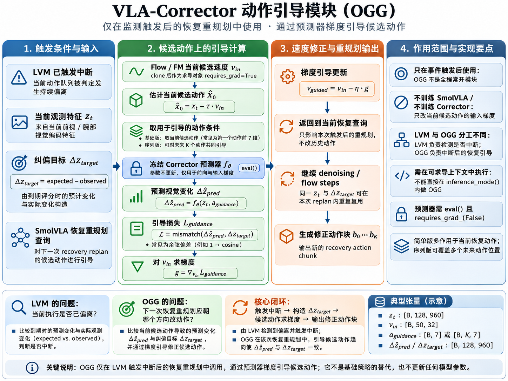

# 技术报告：SmolVLA-Corrector

  <strong>简体中文</strong> · <a href="TECHNICAL_REPORT.en.md">English</a>

[中文README](../README.md) · [English README](../README.en.md) · [复现说明](REPRODUCTION.md) · [来源与许可](../THIRD_PARTY.md)

## 摘要

针对视觉—语言—动作模型（Vision-Language-Action，VLA）在执行较长动作块（Action Chunk）期间难以及时响应环境状态变化的问题，本项目以 SmolVLA 为基础策略，在 LIBERO 环境中复现 VLA-Corrector 的视觉动态预测、潜空间视觉监测（LVM）和在线梯度引导（OGG）机制，并研究其闭环效果、计算开销与跨任务适用性。在 Object10 的 60 组配对条件下，MLP-LVM 成功 55 次（91.7%），较固定执行窗口 H20（51/60）和 H50（44/60）分别提高 **6.7 与 18.3 个百分点**；OGG 未在该组实验中带来额外成功回合。但在 Spatial、Goal、Long 三个任务套件的主要对照中，LVM 并未保持相对于 H20 的优势。本项目还比较了残差 MLP、历史视觉 Transformer 与多步动作条件 Transformer 等预测器配置，分析离线预测能力与闭环性能之间的关系。结果表明，事件触发重规划在特定任务条件下可能带来收益，但不能据此推断其具有普遍的跨任务优势。

## 1. 研究背景与问题定义

### 1.1 Action Chunk 的执行局限

VLA 策略通常根据当前图像、语言指令和机器人状态生成未来一段动作序列。设一次生成的动作长度为 \(C\)，固定策略实际执行的动作前缀长度为 \(H\)，一般满足 \(H\leq C\)。在这 \(H\) 步内，机器人可以持续执行缓存动作，而无需每一步都重新调用较大的 VLA 模型。这有助于减少策略推理调用，也能保持动作在短时间内的连续性。

然而，**生成动作时观察到的环境不一定能代表后续执行过程中的真实环境**。例如，机械臂未能成功抓取目标物体，或物体在接触后发生滑移，旧动作块中后续的移动与放置指令便可能失去适用性。如果仍执行这些动作，状态偏差可能进一步累积。将固定窗口 \(H\) 缩短能够提高观测与重规划频率，但同时增加 VLA 调用次数；固定的 \(H\) 也无法根据不同任务阶段的执行状态动态调整。

[查看 H50 抓取失败的仿真片段](../media/showcase/H50_failure.mp4)。在该示例中，机械臂未能完成抓取，却仍按已生成的动作序列继续运动。该视频用于说明问题情形，**不代表随机抽取的完整实验结果，也不能单独证明任何方法的优劣**。

### 1.2 研究目标与评价维度

VLA-Corrector 的思路是在冻结基础 VLA 策略的前提下，引入外部视觉动态预测器，并在动作执行过程中比较**预测的视觉变化**与**随后实际观测的变化**。如果偏离达到触发条件，系统提前中断当前动作队列并请求重新规划；必要时利用预测器梯度影响恢复动作的生成。

本项目重点考察四个问题：一是 LVM 相较 H50、H20 等固定执行窗口能否提高闭环成功率；二是 OGG 能否在 LVM 之外带来额外收益；三是历史视觉信息与多动作条件能否改善预测及在线表现；四是这些收益是否能够跨任务保持，并且是否值得新增的监测计算开销。

这里需要区分不同层次的指标：**离线预测损失**衡量对视觉变化的拟合，**监测与触发记录**反映系统何时判断需要重新规划，**任务成功率**评价完整操作结果，而**策略调用次数和墙钟耗时**衡量计算代价。

## 2. 方法设计与实现

### 2.1 整体架构

VLA-Corrector 的核心检测与引导思想来自原始 [VLA-Corrector](https://github.com/ZJU-OmniAI/vla-corrector) 研究。本项目基于固定版本源码对接 SmolVLA 与 LIBERO 环境，并开展预测器结构扩展和闭环对照实验；来源、版本与许可见[第三方说明](../THIRD_PARTY.md)。

从职责上看，系统可分为以下三个模块：

1. **视觉动态预测（Corrector）：** 根据冻结 SmolVLA 提取的视觉 Token 及动作条件，预测固定时间跨度后的视觉特征变化。
2. **潜空间视觉监测（LVM）：** 在预测到期且对应观测已到达时，计算预测变化与实际变化的偏离，并结合历史评分及阈值状态机决定是否提前中断。
3. **在线梯度引导（OGG）：** 当 LVM 决定中断后，仅在随后一次恢复重规划中，通过冻结预测器对候选动作的输入梯度引导动作生成。

在整个系统中，基础 SmolVLA 仍负责生成和执行动作，Corrector 不能替代 VLA 本体。**LVM 负责“是否重规划”，OGG 负责“重规划时如何引导候选动作”**；二者具有不同的输入、损失和调用时机。

### 2.2 视觉动态预测模型

#### 2.2.1 输入来源与预测目标

预测器使用冻结 SmolVLA 的视觉编码路径。前视相机和腕部相机经过图像编码器及 Connector 等处理，所得视觉 Token 沿序列维拼接。在 Object10 使用的两路相机配置下，当前视觉特征为

\[
Z_t\in\mathbb R^{B\times128\times960},
\]

其中 \(B\) 是批次大小；128 是两路相机的 Token 总数；960 是每个 Token 的特征维度。

原始单动作预测器还接收一个由动作专家生成的的 7 维动作 \(a_t\in\mathbb R^{B\times7}\)。训练时动作来自示教轨迹，在线时来自动作专家当前规划并即将执行的动作。模型学

\[
\widehat{\Delta Z}_{t\rightarrow t+k}=f_\theta(Z_t,a_t),\qquad
\Delta Z_{t\rightarrow t+k}=Z_{t+k}-Z_t.
\]

输出与 \(Z_t\) 形状相同，但语义是**未来视觉特征变化量**，而不是未来图像或动作。训练数据中的 \(Z_{t+k}\) 只用于构建监督目标，并不作为输入提供给预测器。

 Object10 训练数据使用 10 Hz 示教数据和 \(k=10\)，因此预测跨度约为 **1 秒**。在线 LIBERO 环境以 20 Hz 控制时，相同物理跨度对应 **20 个环境控制步**以实现时间对齐。

#### 2.2.2 残差 MLP 基线

原始 MLP 将 7 维动作映射为 256 维动作嵌入，并广播到全部视觉 Token；每个 Token 与 960 维视觉特征拼接后，得到 1,216 维输入。随后依次经过输入投影、**4 个宽度为 2,048 的残差 MLP 块**、归一化和输出投影，得到与输入视觉特征同形状的预测变化量。实际 Object10 MLP 训练记录对应 **38,052,800 个参数**，可近似表述为 38.05M。

正式训练使用 MSE 与余弦方向损失的组合：

\[
\mathcal L_{\mathrm{pred}}=
\operatorname{MSE}(\widehat{\Delta Z},\Delta Z)
+\beta\Bigl(1-\cos\bigl(\operatorname{vec}(\widehat{\Delta Z}),\operatorname{vec}(\Delta Z)\bigr)\Bigr).
\]

其中 Object10 记录的 \(\beta=1\)，损失在批次上取平均。MSE 约束变化量的数值差异，余弦项衡量视觉变化向量的方向一致性。（注意此处是**离线训练预测器的监督损失**，与第2.4节的在线OGG引导损失相似但是不同。）

#### 2.2.3 为什么研究预测器精度：从基线误差出发

原始Corrector的判断依据不是直接的抓取成功标签，而是“预期视觉变化”和“实际视觉变化”之间的差异。因此，我们首先提出一个**需要验证、而非预先成立的假设**：如果预测器不能充分描述正常操作下的视觉变化，那么正常行为也可能产生较高偏离分数，或者对于异常状态的检测能力不足，影响LVM阈值校准和中断决策；改善预测器的质量或许有助于使监测信号更可靠。

不过，“预测误差仍然存在”并不代表“闭环失败主要由预测误差造成”。为避免直接用复杂结构替换MLP，我们先在相同的454条Object10示教数据及固定训练/验证划分上训练了五种预测器，每种使用3个训练随机种子（42、43、44），并统计最佳Checkpoint在验证集上的预测误差。

| 预测器 | 历史视觉帧数 | 动作条件 | 验证MSE（3种子均值±标准差） |
| --- | ---: | --- | ---: |
| 残差MLP | 1 | 当前1个动作 | 4.0316 ± 0.0149 |
| Transformer-H1 | 1 | 当前1个动作 | 3.8817 ± 0.0186 |
| Transformer-H3 | 3 | 当前1个动作 | 3.9051 ± 0.0263 |
| Transformer-A10-H1 | 1 | 10个示教动作 | **3.6315 ± 0.0134** |
| Transformer-A10-H3 | 3 | 10个示教动作 | 3.6627 ± 0.0197 |

原始MLP在这一验证划分上的零变化预测基线MSE约为**11.545**，而训练后的MSE约为**4.032**，这说明它已经学到了一定的视觉动态规律，但不足以证明它在实际闭环中已经具有可靠的提前异常检测能力。

数据来源：[15组训练与评测审计](https://github.com/30thinkdiff/robot-lab/blob/091272fd3fa4e0144d2e96683b72089a5a96a216/studies/policy_generalization/results/20261111/RESULTS.md)；[训练指标明细](../results/object10/training_runs.csv)。

#### 2.2.4 历史视觉与多动作

第一项尝试是**增加历史视觉观测**。单时刻图像特征能够描述当前外观，却不一定足以区分物体正在滑动、夹爪正在接近还是刚刚发生接触等不同运动状态。我们猜想增加最近三帧视觉特征或许可以为模型提供短时变化趋势，从而改善下一秒的视觉特征变化预测。实现上使用Transformer对历史Token及动作Token进行联合建模，最后仍只预测一个未来时间点的视觉特征变化。

最终实验结果未能直接证实“增加历史帧必然提高精度”：同为单动作条件时，H3的验证MSE为**3.9051**，高于H1的**3.8817**；而在10动作条件下，A10-H3的**3.6627**同样高于A10-H1的**3.6315**。

相关解释有待探索。

第二项尝试是**增加动作条件的时间覆盖**。原始单动作模型只给出 \(a_t\)，却需要预测约1秒后的视觉变化；这一过程中真实执行的后续动作可能影响结果。因此，我们探索使用未来预测跨度内的动作序列是否可以减少预测条件的不确定性。A10模型在训练时读取同一示教Episode中 \([t,t+10)\) 的**实际执行动作**，并以动作时间嵌入区分序列位置。

A10-H1在验证集上取得五种配置中最低的MSE，但**离线预测精度并没有转化为更好的闭环结果**。使用各模型训练种子42的Checkpoint，在同一组60个Object10条件下，MLP-LVM为**55/60**，H1/H3单动作Transformer分别为**55/60、56/60**，A10-H1/H3的LVM结果却为**50/60、51/60**。

关键区别在于条件来源：训练阶段有完整的示教动作，在线阶段只有当前策略已经规划的动作；这些动作可能被重规划替换，且剩余队列未必足够提供10个有效条件。原实现要求动作条件可用才预测，并在规划失效时撤销依赖旧动作块的预测。对应A10两组LVM的预热后有效评分覆盖率约为**59%**，而原单动作模型为100%。

为解决“规划动作条件过期”的限制，后续增加了**已执行动作到期监测**：它不预先把整个未来计划当成最终执行事实，而是结合实际提交的动作记录形成到期比较。

从上面的信息来看，输入也不是越多越好，而是：**有用的额外条件必须在部署时真实可得，并且必须考虑动作执行、规划失效与视觉预测到期之间的时间关系，同时得和自身模型架构和规模适配**

来源：[原五模型与覆盖率审计](https://github.com/30thinkdiff/robot-lab/blob/091272fd3fa4e0144d2e96683b72089a5a96a216/studies/policy_generalization/results/20261111/RESULTS.md)；[已执行动作扩展评测](https://github.com/30thinkdiff/robot-lab/blob/091272fd3fa4e0144d2e96683b72089a5a96a216/studies/policy_generalization/results/20261112/overnight_review/RESULTS.md)；[在线适配源码](../implementation/corrector_online_runtime.py)。

#### 2.2.5 多层视觉信息：研究动机与选层依据

前述尝试主要改变预测器的时序输入和动作条件，视觉监督仍以SmolVLA最终Connector输出为主。这使我们进一步考虑另一种可能性：**最终Connector表示是否保留了在线监测所需的全部视觉变化信息？我们能否融合不同维度的视觉信息呢？** 在视觉编码器中，不同深度的特征经过逐层变换，可能对局部外观变化、物体接触状态和较抽象的语义信息具有不同敏感性。若某些变化在最终投影空间中不够明显，单一Connector偏离分数可能遗漏有用信号。

在这个示例中，机械臂并没有夹持着物体，但是也没有触发中断。

实际视觉模块具有**12个Transformer Block（从0编号）**；原始中间层每路相机输出形状为 \([1,1024,768]\)，而Connector每路为 \([1,64,960]\)。我们最终把较早的Block 2、较深的Block 8和最终Connector作为三个代表性位置：这样既覆盖不同深度的中间表示，又保持层数和训练开销可控。

为了测试“不同视觉层能否独立改善闭环表现”，后来又在**完整454条示教**上分别训练Block 2和Block 8的单层残差MLP（各一个训练seed），并对相同60组Object10条件评测。S2-LVM、S8-LVM均为**53/60**，S2-OGG为**53/60**，S8-OGG为**54/60**；原Connector MLP-LVM/OGG均为**55/60**。这些结果说明中间层本身能支持有效预测和重规划，**没有证明替换Connector后能获得更高成功率**。比较仍包含特征提取精度、缓存协议和训练运行条件差异，不能由一两个成功回合的差异推断层级优劣。

来源：[多层特征读取与初步探针](https://github.com/30thinkdiff/robot-lab/blob/091272fd3fa4e0144d2e96683b72089a5a96a216/studies/policy_generalization/corrector/MULTILAYER_DESIGN.md)；[真实提取指标](https://github.com/30thinkdiff/robot-lab/blob/091272fd3fa4e0144d2e96683b72089a5a96a216/studies/policy_generalization/results/20261112/multilayer_probe/summary.json)；[正式设计说明](https://github.com/30thinkdiff/corrector/blob/39d6f61e33be5b1d928071ab8953f5ab8030c98d/studies/policy_generalization/corrector/FORMAL_MULTILAYER_CORRECTOR_J36M_DESIGN_20261112.md)；[单层Block 2/8正式对照](https://github.com/30thinkdiff/robot-lab/blob/091272fd3fa4e0144d2e96683b72089a5a96a216/studies/policy_generalization/results/20261120/single_layer_object60/RESULTS.md)。

#### 2.2.6 J-36M联合预测器与分层对照

为检验三种表征能否提供互补信息，我们实现了联合多层预测器（记为**J-36M**，约3,679万参数）。它仍接收**当前一个7维动作**，不与上一节的10动作条件实验混为一项改动。其核心结构为：

- 保留Block 2、Block 8两路相机的**全分辨率32×32 Token**作为输入及监督目标，形状均为\([B,2,1024,768]\)；Connector仍为\([B,128,960]\)。
- 在模型内部按每4×4个相邻Patch形成一个局部分组，与Connector的8×8网格在空间分组数上对应。各层经过独立Adapter投影，随后进行跨层融合，并由共享Transformer主干建模。**这种分组是模型内部的可逆排列，不意味着把中间层监督目标池化为8×8**。
- 通过三个输出头分别预测Block 2、Block 8与Connector的未来特征变化；中间层还包含局部跳跃路径，以保留细粒度残差。动作经条件映射参与主干计算，使该预测器仍可供OGG对候选动作求梯度。

对多层预测损失，不能直接将三个特征空间的原始MSE相加：以同一数据的零变化预测为例，Connector的逐元素MSE远大于Block 2/8，数值尺度足以主导联合损失。J使用**仅由训练集估计的层内变化RMS**进行尺度归一化，并在训练中采用Block 2、Block 8、Connector分别**0.25、0.25、0.50**的权重；另有等权版本J_equal。在线LVM的可靠性融合权重则来自独立正常轨迹校准，**与训练Loss权重不是一回事**。

为区分“增加中间层信息”和“增加辅助监督目标”，我们还设置了仅预测Connector的C0、分别只预测Block 2/8的S2/S8等对照。首轮正式J实验使用**70条示教（50训练、20验证）**，覆盖10个任务；它与原五模型的**454条（364训练、90验证）**不属于同一训练数据预算。

在70条数据的验证集上，已有同来源统计如下：

| 配置 | Connector验证MSE | Block 2验证MSE | 解释边界 |
| --- | ---: | ---: | --- |
| C0（仅Connector） | **5.1495** | — | 70条数据下的单目标基线 |
| J_equal（联合等权） | 5.2480 | 0.02355 | 同样的联合架构，改变损失权重 |
| J-36M（联合加权） | 5.2119 | 0.02372 | Connector及中间层均未表现出普遍最优 |
| S2（仅Block 2） | — | **0.01909** | 只比较该层自身的预测目标 |

这些数值来自相同70条数据协议下的验证记录，但模型目标、结构和Checkpoint选优准则不同。**J并没有在Connector的原始MSE上胜过C0，Block 2也没有胜过独立S2**。这说明现有证据不足以宣称跨层共享主干已经利用互补信息实现了更高预测精度，也不能仅凭上述差异认定存在确定的多任务负迁移。此阶段S8训练曾在24轮暂停，不应把它与完成60轮的其他条件当作同预算对照。

联合J-36M在后续正式Object10对照中LVM/OGG均为**55/60**；在选定的LIBERO-Plus首轮32条件中均为**9/32**，而旧MLP两方法为**11/32**、固定H20为**20/32**。这些实验检验了方法在不同任务条件下的表现，但J与旧MLP的训练数据、视觉精度及融合校准并未完全一致，因此**不是严格意义上仅改变多层输入的一项消融**。当前结论应是：多层视觉融合的工程实现与闭环验证已经完成，**稳定优于单层Connector的假设尚未得到支持**。

来源：[同数据协议的分层验证指标](https://github.com/30thinkdiff/robot-lab/blob/091272fd3fa4e0144d2e96683b72089a5a96a216/studies/policy_generalization/results/20261114/expanded_snapshot_20261113T161434Z/training_layers.csv)；[J-36M与Plus总结](https://github.com/30thinkdiff/robot-lab/blob/091272fd3fa4e0144d2e96683b72089a5a96a216/studies/policy_generalization/research_report.md)。

### 2.3 在线监测模块（LVM）

LVM 用于判断执行过程是否**偏离此前预测的视觉信息变化**，从而决定是否丢弃剩余动作并提前重新规划。

#### 2.3.1 预测登记与到期评分

控制步 \(t\) 时，系统保存当前视觉特征 \(Z_t\)、预测变化量 \(\widehat{\Delta Z}_{t\rightarrow t+k}\) 及到期时刻 \(t+k\)，将其加入待评估预测队列。只有到期观测真正到达后，才能计算

\[
\Delta Z^{\mathrm{obs}}_{t\rightarrow t+k}=Z_{t+k}-Z_t,
\]

以及视觉偏离分数

\[
E_{t+k}=1-\cos\Bigl(
\operatorname{vec}(\widehat{\Delta Z}_{t\rightarrow t+k}),
\operatorname{vec}(\Delta Z^{\mathrm{obs}}_{t\rightarrow t+k})\Bigr).
\]

#### 2.3.2 Bootstrap、动态阈值与触发条件

本项目使用原代码的 \`RobustThresholdState\` 和 \`robust_threshold_step\` 实现状态机，其核心过程为：

1. **平滑与Bootstrap校准。** 对有效评分应用指数加权移动平均（EWMA）；在 Bootstrap 阶段积累校准样本并作为后续中位数计算的初始分布。设置需要 15 个有效评分，校准完成前不会触发中断。
2. **鲁棒双阈值。** 对最近的历史评分计算中位数与中位绝对偏差（MAD），构造触发阈值 \(T_{\mathrm{on}}\) 和释放阈值 \(T_{\mathrm{off}}\)，并设置基础噪声下限(noise_floor)。通过比较当前误差与高、低阈值切换状态。
3. **持续超阈与突变检测。** 若误差超过高阈值条件，对应中断计数器计数,达到设定耐心后触发中断。同时保留满足额外条件的突变触发路径。
4. **报警保持与可选冷却。** 状态机还维护 \`alert_active\`、连续低于释放阈值的计数及可配置冷却。低分持续满足重置条件后解除报警；冷却期间普通重触发受到限制，但是还是可能触发。

#### 2.3.3 中断及后续动作处理

我们的实现支持三种监测相关模式以判断各个模块的影响：monitor只记录评分、不打断动作；lvm在触发条件成立时清空动作队列并重新调用基础策略；ogg在同样的中断之后，为紧接着的一次恢复重规划额外开启梯度引导。

源码：[在线运行适配](../implementation/corrector_online_runtime.py)、[偏离评分练习与核心计算](../implementation/corrector_online_practice.py)。

### 2.4 动作引导模块（OGG）

OGG 只作用于**LVM触发中断后紧接着的一次恢复重规划**，但是要注意OGG的最小作用单位时间是当前一个完整动作序列的多步Flow Matching过程中的某个积分步。它与 LVM 的分工是：LVM 判断当前动作是否应提前停止；OGG 尝试影响下一次候选动作的生成方向。两者并不在每个控制步持续共同优化。

当一份预测到期时，系统已经得到预测变化 \(\widehat{\Delta Z}\) 与实测变化 \(\Delta Z^{\mathrm{obs}}\)。在线实现将二者之差构造为潜空间修正目标：

\[
\Delta Z_{\mathrm{target}}
=\widehat{\Delta Z}-\Delta Z^{\mathrm{obs}}.
\]

在 SmolVLA 的 Flow Matching 采样过程中，设当前去噪状态为 \(x_\tau\)、速度场为 \(v_\tau\)、Flow Matching 时间变量为 \(\tau\)。实现首先构造候选干净动作估计

\[
\widehat{x}_0=x_\tau-\tau v_\tau.
\]

单动作预测器选取该动作块第一个位置的有效7维动作，与当前视觉特征一起送入冻结的 Corrector，得到候选动作对应的预测视觉变化 \(\widehat{\Delta Z}_{\mathrm{cand}}\)。随后计算

\[
\mathcal L_{\mathrm{OGG}}=
1-\cos\Bigl(
\operatorname{vec}(\widehat{\Delta Z}_{\mathrm{cand}}),
\operatorname{vec}(\Delta Z_{\mathrm{target}})\Bigr),
\]

并对候选速度场求梯度，通过

\[
g_\tau=\nabla_{v_\tau}\mathcal L_{\mathrm{OGG}},\qquad
v_\tau^{\mathrm{guided}}=v_\tau-\eta g_\tau
\]

调整当前去噪步骤的速度，其中 \(\eta\) 控制引导强度。调整后的速度用于继续生成动作块；代码通过 \`guidance_every\` 控制引导频率。

这一过程会临时启用**对候选速度场的梯度**，但 SmolVLA 与 Corrector 均保持冻结，不更新其模型参数。

在对OGG的消融实验分析中，我们发现OGG带来的收益非常有限，为此，我们对OGG的误差组成、引导强度 $\eta$、引导频率guidance_every进行了分析。

#### 2.4.1 OGG误差组成分析

OGG初始实现采用余弦引导；我们进一步比较了原始MSE、余弦以及二者相加的引导损失驱动下的OGG性能。在8个选定条件、2个评测seed、MLP/J各3种损失的**96条回合**中，MLP-OGG三种Loss均为**11/16**；J-OGG分别为**7/16、9/16、8/16**。

#### 2.4.2 OGG引导强度分析

原始MSE产生的梯度幅值与余弦项不同，需要通过调整引导强度来平衡不同损失函数的影响。

#### 2.4.3 OGG引导频率分析

源码：[OGG核心计算](../implementation/corrector_online_practice.py)、[多动作引导扩展](../implementation/corrector_models.py)、[在线触发与调用](../implementation/corrector_online_runtime.py)。

### 2.5 研究路线、验证原则与工程贡献

本项目并非在已有Corrector上不断叠加网络结构，而是围绕一个反复接受检验的研究问题推进：**视觉预测误差、可用的动作条件、监测判定规则与动作引导，哪一环节真正限制了闭环操作的收益？** 为了避免把不同机制的效果混淆，我们逐步建立了以下验证关系。

| 研究假设 | 设计的验证 | 当前观察 | 结论强度 |
| --- | --- | --- | --- |
| 原始单动作预测可能遗漏运动趋势 | MLP与历史Transformer，同数据/不同训练seed比较验证误差，再做配对闭环 | H3未在验证MSE上稳定优于H1；Object10各组LVM接近 | **未证明增加历史帧必然有益** |
| 使用更多未来动作能降低预测不确定性 | A10离线验证、在线计划条件监测、已执行动作到期对照 | A10离线MSE较低，但原在线LVM成功率下降；更改动作条件可提升部分配对结果 | **证实条件时序重要，未分离单一因果因素** |
| 多层视觉信息可能补足Connector未保留的变化 | 中间层只读提取、S2/S8单层模型、J/C0/J_equal对照及闭环评测 | 中间层能用于预测与监测；J未稳定超过单层Connector | **互补性与最优层选取仍是待验证假设** |
| 引导Loss变化可能改变候选动作修正方向 | 冻结模型/检测规则，在选定条件下对比余弦、MSE及二者组合 | 动作与结局出现部分翻转，整体收益不稳定 | **可改变优化过程，不等于普遍提高成功率** |

#### 2.5.1 离线预测与在线决策不能互相替代

仅观察正常示教数据的验证MSE，无法直接判断LVM何时会误报或漏报：模型部署后看到的是**由当前策略执行形成的状态分布**，而不是固定的专家示教轨迹。为更直接审查这一差异，项目在同一批**572条H50执行轨迹**上，以真实已执行动作重新评估五个预测器。A10-H1的完整回合宏平均MSE约为**11.50**，MLP约为**12.15**，但这并不意味着前者一定能提前发现失败。

同一诊断还比较了**全回合误差与最终回合失败**的关联，以及限制在较早执行时段的关联。MLP全回合误差对最终失败的回合级AUC约为**0.971**，而早期窗口降至**0.568**；A10-H1相应约为**0.967**和**0.631**。由于失败本身也可能改变后续视觉变化，全回合高AUC可能部分反映“失败后误差更大”的结果，**不能解释成模型能够提前检出异常的AUC**。这些AUC的标签是回合最终成败，并非人工核验的逐步异常事件。

因此，后续改善工作的合理顺序应是：先核对**同一来源的训练/验证误差与基线**，再在**相同真实执行轨迹**上比较预测误差和有效评分条件，最后才通过**配对闭环实验**判断策略收益。若没有独立逐步异常标签，就不能以当前偏离分数直接报告真实异常检测准确率。

来源：[同轨迹误差与成败诊断](https://github.com/30thinkdiff/robot-lab/blob/091272fd3fa4e0144d2e96683b72089a5a96a216/studies/policy_generalization/results/20261112/overnight_review/RESULTS.md)、[逐模型在线预测误差](https://github.com/30thinkdiff/robot-lab/blob/091272fd3fa4e0144d2e96683b72089a5a96a216/studies/policy_generalization/results/20261112/overnight_review/prediction_accuracy.csv)。

#### 2.5.2 监测协议与OGG也需要单变量核查

预测器以外的机制同样会影响结果。例如，J的早期部署曾在LVM中断时额外清空尚未到期的**单动作**视觉预测，使下一份预测成熟前出现19个控制步的评分空窗。随后对照原始VLA-Corrector的动作队列语义，确认原单动作方法在中断时清空的是**尚未执行的动作**，并不需要同步清空所有待到期预测。修复之后，在独立小规模配对中恢复了有效评分覆盖，但**评分次数、重规划次数及个别终局也随之改变**。

这属于控制适配与评测协议的修正，不能包装成“新模型优化了监测覆盖率”，也不能把早期错误协议下的结果与修正后的正式结果直接归并。后续正式Object10六方法采用上游动态阈值历史、每回合Bootstrap与默认无冷却配置；另经CPU重放核对，J/MLP四组240回合的**30,389次评分**在阈值和触发事件上均与保存Trace一致。但J还使用独立正常轨迹标定的分层可靠性权重，因此“同一个阈值状态机”并不等于“两个模型的输入评分与校准完全相同”。

这部分结果支持继续研究**评分校准、动作条件、引导方向与计算预算之间的关系**，但目前没有证据证明简单增加监测层数、延长训练或替换OGG损失，就能稳定提升闭环成功率。

来源：[预测保留协议对照](https://github.com/30thinkdiff/robot-lab/blob/091272fd3fa4e0144d2e96683b72089a5a96a216/studies/policy_generalization/results/20261113/j36m_retention_preserve/RESULTS.md)；[正式协议复核](https://github.com/30thinkdiff/robot-lab/blob/091272fd3fa4e0144d2e96683b72089a5a96a216/studies/policy_generalization/results/20261118/storage_protocol_audit/RESULTS.md)；[OGG损失扩展](https://github.com/30thinkdiff/robot-lab/blob/091272fd3fa4e0144d2e96683b72089a5a96a216/studies/policy_generalization/results/20261116/ogg_loss_extension/RESULTS.md)。

#### 2.5.3 本项目的工作范围及证据

为区分原论文贡献与本项目的复现、适配和扩展，主要工作归纳如下：

| 工作内容 | 已完成工作和证据 | 不应作出的延伸 |
| --- | --- | --- |
| 上游方法的复现与集成 | SmolVLA/LIBERO对接，Corrector训练、在线LVM/OGG、动作缓存与时间尺度对齐；[在线实现](../implementation/corrector_online_runtime.py) | 不将原始Corrector、LVM、OGG称为个人提出的新算法 |
| 多结构预测器实验 | MLP、H1/H3 Transformer与A10条件实验，15组训练及配对闭环；[训练记录](../results/object10/training_runs.csv) | 不以最佳验证MSE替代闭环成绩 |
| 多层特征与J-36M | 只读特征提取、独立单层对照、联合三层预测与层内尺度校准；[研究归档](https://github.com/30thinkdiff/robot-lab/blob/091272fd3fa4e0144d2e96683b72089a5a96a216/studies/policy_generalization/research_report.md) | 不把候选层选择或未胜出的联合模型宣传为已验证的改进 |
| 执行监测与梯度引导审计 | 评分队列、阈值和触发的Trace回放、OGG梯度与多Loss诊断；[配对结果](../results/object10/paired_comparisons.csv) | 不把梯度非零当作任务收益，不将开发期协议偏差当作算法贡献 |
| 外部条件与复现支持 | LIBERO其他套件、选定Plus条件、逐回合指标及RobotLab Replay；[跨任务记录](../results/cross_suite/) | 不将相关初始状态/seed当作独立场景，也不声称完整官方基准复现 |

**本章的作用是交代每项尝试为什么提出、如何设计和验证，以及结果是否支持原有假设。** 更完整的样本划分、控制参数、训练协议、配对成败与统计局限应在第3、4章单独列明，避免在方法章节里用大量成功率取代实验分析。

## 3. 数据与评测协议

- **基础策略：** 固定版本SmolVLA-LIBERO；模型和上游环境版本见[第三方来源](../THIRD_PARTY.md)。
- **Object10：** 10个任务、454条示教、66,984帧；5种预测器配置×3训练随机种子，共15组训练。这里展示的MLP基线为每种方法**60组同条件配对回合**。
- **跨任务评测：** 880个正式回合、220组四方法配对。主要比较为Spatial、Goal、Long三套件，每套件每方法40回合。补充初始状态和固定LIBERO-90十任务子集使用独立分母。
- **LIBERO-Plus执行窗口：** 32个筛选条件，每种固定窗口32回合、一个评测随机种子。

**【待作者完善】** 补充控制频率、Chunk生成长度和执行前缀、各任务步数上限、初始状态的记录与审计方式、训练/评测seed、Checkpoint版本、成功定义和耗时统计口径。

未核对基础策略训练任务覆盖时，不应将跨任务测试全部称作基础策略的零样本泛化。

## 4. 实验结果

### 4.1 Object10：配对闭环成功率

| 方法 | 成功回合 / 总回合 |
| --- | ---: |
| 固定执行H50 | 44/60 |
| 固定执行H20 | 51/60 |
| MLP + LVM | 55/60 |
| MLP + OGG | 55/60 |

在这些Object10配对条件下，MLP-LVM的成功回合高于固定窗口。但**OGG并没有相对LVM增加成功回合**；不能把相对于H20的全部差值归因于OGG。减少动作块生成次数也不等于端到端耗时下降，因为监测涉及额外计算。

来源：[闭环汇总](../results/object10/closed_loop.csv)和[配对对照](../results/object10/paired_comparisons.csv)。

### 4.2 跨任务结果

| 方法 | Spatial + Goal + Long：主要比较 |
| --- | ---: |
| 固定执行H50 | 81/120 |
| 固定执行H20 | 93/120 |
| MLP + LVM | 80/120 |
| MLP + OGG | 77/120 |

**【待作者完善】** 分任务套件核对配对胜负和失败类型。明确区分直接测量的结果与失败原因推断。当前主要结果只涉及指定的MLP训练模型，不能外推为所有Corrector结构都没有跨任务价值。

来源：[逐回合记录](../results/cross_suite/trials.csv)、[分方法结果](../results/cross_suite/methods.csv)。

### 4.3 监测覆盖率与动作条件

**【待作者完善】** 根据[覆盖率记录](../results/object10/monitor_coverage.csv)，分析单动作条件模型在定义的可评分步上覆盖100%、10动作条件模型约59%的差别。讨论预测取消、条件过期、历史窗口与动作队列等因素，但不能把覆盖下降直接断言为成功率降低的唯一原因。

### 4.4 执行前缀与计算代价

在选定32个LIBERO-Plus条件中，固定执行窗口成功数为：H50 **7/32**、H20 **20/32**、H10 **19/32**、H5 **15/32**、H1 **6/32**。

**【待作者完善】** 结合VLA调用次数、真实监测耗时、环境步数和墙钟时间，分析执行前缀与成本的权衡。这组筛选条件不能代表普遍最优窗口。

来源：[LIBERO-Plus实验结果](../results/plus_horizon/plus_horizon_results.csv)。

### 4.5 典型案例

**【待作者完善】** 从真实实验归档选择2—3组完整的配对视频/轨迹，包括至少一例未能纠偏或性能退化。每段视频应能对应具体任务、初始化、seed、方法、模型版本和原始文件。已挑选案例只能作为机制说明，不得当成随机样本的统计代表。

## 5. 失败分析、局限与后续假设

**【待作者完善】** 至少讨论：

- Object10正向结果未在跨任务主要比较中稳定维持；
- OGG梯度更新真实发生，不意味着最终任务成功；
- 视觉监测增加了实际墙钟开销；
- 离线预测误差与闭环成功率不是同一个指标；
- 动作条件可用性会影响监测评分覆盖；
- 多个seed与重复初始化未必构成独立物理场景；
- 已通过CPU结果复算，不等于已在干净环境完成GPU端到端复现。

对可能的原因逐条区分：**实测事实 / 基于数据的推断 / 尚未验证的假设**。

## 6. 结论

**【待作者完善｜约120—200字】** 同时呈现Object10的有条件收益、跨任务负结果与局限，再说明一个具有明确验收指标的下一步研究方向，不要将适用边界写成普遍成立。

## 附录A：公开结果复算

~~~bash
python scripts/check_source_integrity.py
python scripts/reproduce_results.py --format markdown
python -m unittest discover -s tests -v
~~~

此处命令为CPU/标准库检查，不会重新训练或运行仿真。

## 附录B：版本与来源

参见 [source_map.json](../provenance/source_map.json)、[复现说明](REPRODUCTION.md)和[第三方声明](../THIRD_PARTY.md)。

## 附录C：参考文献

- Pan et al. *VLA-Corrector: Lightweight Detect-and-Correct Inference for Adaptive Action Horizon*. NeurIPS 2026. https://github.com/ZJU-OmniAI/vla-corrector
- LeRobot / SmolVLA：https://github.com/huggingface/lerobot
- LIBERO：https://github.com/Lifelong-Robot-Learning/LIBERO

**【待作者完善】** 根据正文实际引用补充相关研究，并核实作者、正式题目、年份及版本。

---

**同步约定：** 优先维护本中文报告；后续按中文内容更新[英文技术报告](TECHNICAL_REPORT.en.md)。中英文数值或表述出现冲突时，首先以原始实验数据和实际运行协议为准。
