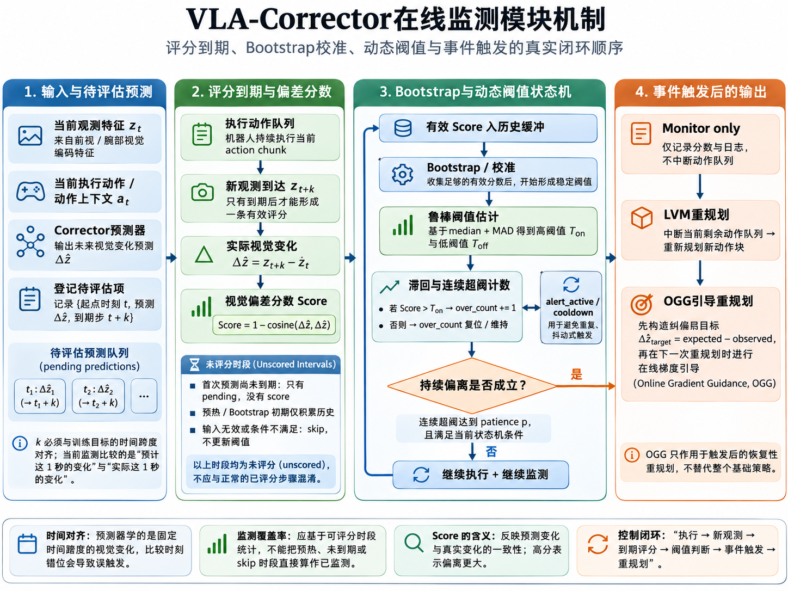

# 技术报告：SmolVLA-Corrector

  <strong>简体中文</strong> · <a href="TECHNICAL_REPORT.en.md">English</a>

[中文README](../README.md) · [English README](../README.en.md) · [复现说明](REPRODUCTION.md) · [来源与许可](../THIRD_PARTY.md)

## 摘要

 针对Action Chunk动作生成机制存在的决策延迟和状态偏离问题，本项目基于VLA-Corrector的视觉动态预测、在线监测和事件触发重规划机制，研究其在闭环成功率、计算开销和跨任务迁移上的实际效果。在Libero场景中的实验结果显示，在Object10任务中，使用smolvla为基础模型，MLP-LVM配置的测试成功率相较于固定执行窗口H20和H50分别提升了6.7%和18.4%，但梯度动作引导模块（OGG）并未带来额外收益同时方法的泛化性能有待进一步验证和提升。在复现原方法的基础上，本项目重点对其预测模型的结构进行了进一步探索。

## 1. 研究背景与问题定义

Action Chunk机制因其生成动作连贯性较强等优势在VLA动作生成中被广泛采用。每一次推理生成动作时，模型会基于当前的观测条件预测接下来C（预测步长）步动作序列并且实际执行H（执行步长）步。在执行旧的动作序列的过程中可能机器人和环境状态并不符合预期，此时仍然执行上一次推理的剩余动作可能会使得状态偏移更加严重，导致无法再规划合理动作。通过降低执行步长H能够在一定程度上缓解这个问题，但是也会带来频繁调用模型进行推理的计算开销，同时固定的H并不能高效适应不同任务。

目前这个任务中，机械臂并没有成功抓到物体，但是仍然按照最初的规划执行了剩余的动作。

针对Action Chunk的这一限制，vla-corrector基于高维视觉信息对机械臂环境状态进行评估并且在必要时触发重新规划，兼顾了计算效率和性能。

## 2. 方法设计与实现

### 2.1 vla-corrector整体架构

视觉动态预测、LVM与OGG的主要思想来自原始[VLA-Corrector](https://github.com/ZJU-OmniAI/vla-corrector)研究，来源与固定版本详见[第三方说明](../THIRD_PARTY.md)。

vla-corrector主要由预测模型、在线监测模块和动作引导模块这三个模块组成。预测模型基于历史视觉特征和动作序列预测未来的视觉特征，在线监测模块根据预测结果和实际观测结果的差异判断是否需要重新规划，动作引导模块则在重新规划时提供梯度信息以引导VLA生成更合理的动作序列。

### 2.2 预测模型

预测模型的输入来自冻结的smolvla模型中经过SigLIP处理并且经过connector处理后的视觉token以及当前待执行动作序列中的第一个动作，输出是同样形状的视觉token，但是其意义为预测的未来视觉特征token变化量。即预测模型希望能够基于当前视觉观测和未来动作预测多步后的视觉特征变化信息。这里为什么使用变化信息呢？

预测模型实际上学到的是“当前观测与当前动作所暗示的、在训练示范分布下较常见的后续演化规律”。

我们的尝试包括了以下几点：
1、使用多帧历史视觉特征作为输入，尝试让模型学会最近的视觉演化规律，希望模型能够利用近期视觉特征变化的趋势结合当前动作提高预测的准确率。
2、使用多步未来动作作为输入，尝试提高模型对预测视觉特征变化的准确率。但是在实现时存在模型规划动作与训练时的实际动作分布不一致、规划动作会被中断导致实际后续执行动作完全偏离原规划动作使得最初模型输入不可用等问题。

### 2.3 在线监测

**【待作者完善】** 说明预测、评分到期、Bootstrap校准、阈值更新、连续超阈计数、动作队列中断、重新规划和OGG引导的真实顺序。

区分首次预测到期前的预热、动态阈值校准、监测覆盖率分母和动作条件失效后的未评分时段。

### 2.4 动作引导

### 2.5 本项目的工程工作与扩展

**【待作者完善】** 依据源码与结果审计，按**上游提供 / 本项目实现或修改 / 探索性实验**逐项列明：

- VLA-Corrector与SmolVLA、LIBERO的接口与时序适配；
- 多历史帧及动作序列条件预测器；
- 多层视觉特征和监测扩展；
- LVM、OGG及其他在线监测与控制变体；
- 逐回合配对分析、运行日志和Replay工具。

填写每项贡献对应的代码路径、固定SHA、实际训练或测试证据。

## 3. 数据与评测协议

- **基础策略：** 固定版本SmolVLA-LIBERO；模型和上游环境版本见[第三方来源](../THIRD_PARTY.md)。
- **Object10：** 10个任务、454条示教、66,984帧；5种预测器配置×3训练随机种子，共15组训练。这里展示的MLP基线为每种方法**60组同条件配对回合**。
- **跨任务评测：** 880个正式回合、220组四方法配对。主要比较为Spatial、Goal、Long三套件，每套件每方法40回合。补充初始状态和固定LIBERO-90十任务子集使用独立分母。
- **LIBERO-Plus执行窗口：** 32个筛选条件，每种固定窗口32回合、一个评测随机种子。

**【待作者完善】** 补充控制频率、Chunk生成长度和执行前缀、各任务步数上限、初始状态的记录与审计方式、训练/评测seed、Checkpoint版本、成功定义和耗时统计口径。

未核对基础策略训练任务覆盖时，不应将跨任务测试全部称作基础策略的零样本泛化。

## 4. 实验结果

### 4.1 Object10：配对闭环成功率

| 方法 | 成功回合 / 总回合 |
| --- | ---: |
| 固定执行H50 | 44/60 |
| 固定执行H20 | 51/60 |
| MLP + LVM | 55/60 |
| MLP + OGG | 55/60 |

在这些Object10配对条件下，MLP-LVM的成功回合高于固定窗口。但**OGG并没有相对LVM增加成功回合**；不能把相对于H20的全部差值归因于OGG。减少动作块生成次数也不等于端到端耗时下降，因为监测涉及额外计算。

来源：[闭环汇总](../results/object10/closed_loop.csv)和[配对对照](../results/object10/paired_comparisons.csv)。

### 4.2 跨任务结果

| 方法 | Spatial + Goal + Long：主要比较 |
| --- | ---: |
| 固定执行H50 | 81/120 |
| 固定执行H20 | 93/120 |
| MLP + LVM | 80/120 |
| MLP + OGG | 77/120 |

**【待作者完善】** 分任务套件核对配对胜负和失败类型。明确区分直接测量的结果与失败原因推断。当前主要结果只涉及指定的MLP训练模型，不能外推为所有Corrector结构都没有跨任务价值。

来源：[逐回合记录](../results/cross_suite/trials.csv)、[分方法结果](../results/cross_suite/methods.csv)。

### 4.3 监测覆盖率与动作条件

**【待作者完善】** 根据[覆盖率记录](../results/object10/monitor_coverage.csv)，分析单动作条件模型在定义的可评分步上覆盖100%、10动作条件模型约59%的差别。讨论预测取消、条件过期、历史窗口与动作队列等因素，但不能把覆盖下降直接断言为成功率降低的唯一原因。

### 4.4 执行前缀与计算代价

在选定32个LIBERO-Plus条件中，固定执行窗口成功数为：H50 **7/32**、H20 **20/32**、H10 **19/32**、H5 **15/32**、H1 **6/32**。

**【待作者完善】** 结合VLA调用次数、真实监测耗时、环境步数和墙钟时间，分析执行前缀与成本的权衡。这组筛选条件不能代表普遍最优窗口。

来源：[LIBERO-Plus实验结果](../results/plus_horizon/plus_horizon_results.csv)。

### 4.5 典型案例

**【待作者完善】** 从真实实验归档选择2—3组完整的配对视频/轨迹，包括至少一例未能纠偏或性能退化。每段视频应能对应具体任务、初始化、seed、方法、模型版本和原始文件。已挑选案例只能作为机制说明，不得当成随机样本的统计代表。

## 5. 失败分析、局限与后续假设

**【待作者完善】** 至少讨论：

- Object10正向结果未在跨任务主要比较中稳定维持；
- OGG梯度更新真实发生，不意味着最终任务成功；
- 视觉监测增加了实际墙钟开销；
- 离线预测误差与闭环成功率不是同一个指标；
- 动作条件可用性会影响监测评分覆盖；
- 多个seed与重复初始化未必构成独立物理场景；
- 已通过CPU结果复算，不等于已在干净环境完成GPU端到端复现。

对可能的原因逐条区分：**实测事实 / 基于数据的推断 / 尚未验证的假设**。

## 6. 结论

**【待作者完善｜约120—200字】** 同时呈现Object10的有条件收益、跨任务负结果与局限，再说明一个具有明确验收指标的下一步研究方向，不要将适用边界写成普遍成立。

## 附录A：公开结果复算

~~~bash
python scripts/check_source_integrity.py
python scripts/reproduce_results.py --format markdown
python -m unittest discover -s tests -v
~~~

此处命令为CPU/标准库检查，不会重新训练或运行仿真。

## 附录B：版本与来源

参见 [source_map.json](../provenance/source_map.json)、[复现说明](REPRODUCTION.md)和[第三方声明](../THIRD_PARTY.md)。

## 附录C：参考文献

- Pan et al. *VLA-Corrector: Lightweight Detect-and-Correct Inference for Adaptive Action Horizon*. NeurIPS 2026. https://github.com/ZJU-OmniAI/vla-corrector
- LeRobot / SmolVLA：https://github.com/huggingface/lerobot
- LIBERO：https://github.com/Lifelong-Robot-Learning/LIBERO

**【待作者完善】** 根据正文实际引用补充相关研究，并核实作者、正式题目、年份及版本。

---

**同步约定：** 优先维护本中文报告；后续按中文内容更新[英文技术报告](TECHNICAL_REPORT.en.md)。中英文数值或表述出现冲突时，首先以原始实验数据和实际运行协议为准。
