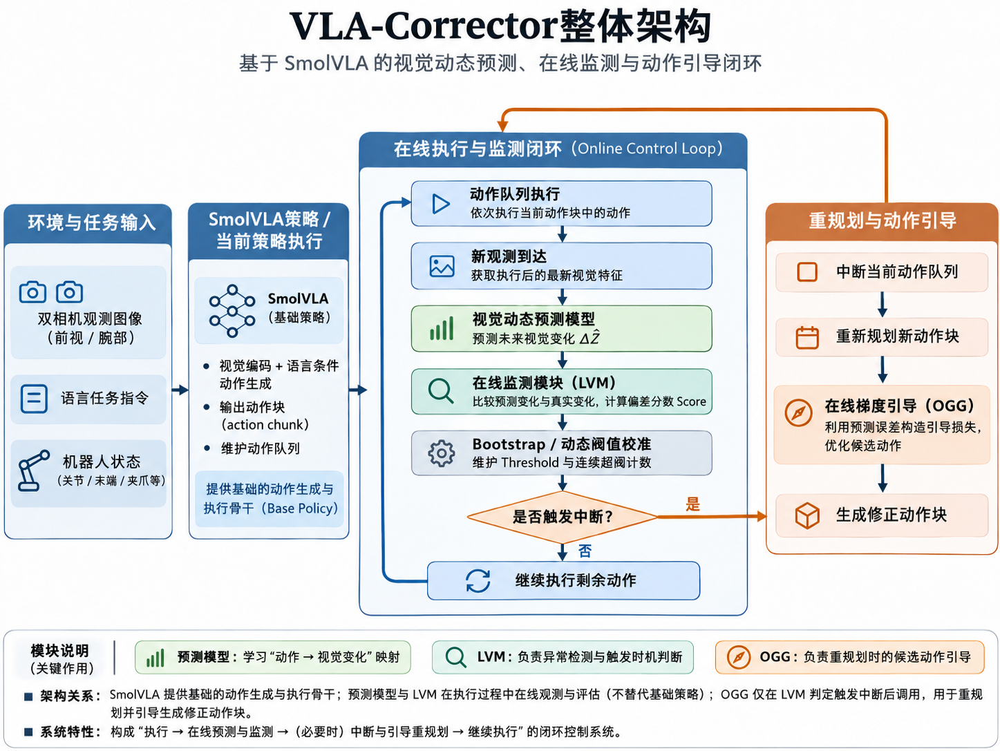
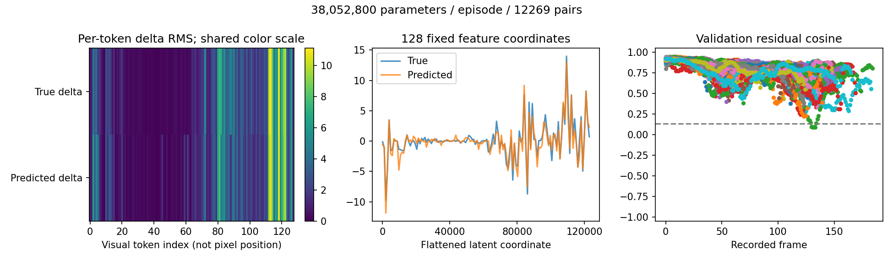

# 技术报告：SmolVLA-Corrector

  <strong>简体中文</strong> · <a href="TECHNICAL_REPORT.en.md">English</a>

[中文README](../README.md) · [English README](../README.en.md) · [复现说明](REPRODUCTION.md) · [来源与许可](../THIRD_PARTY.md)

## 摘要

针对视觉—语言—动作模型（Vision-Language-Action，VLA）在执行较长动作块（Action Chunk）期间难以及时响应环境状态变化的问题，本项目以 SmolVLA 为基础策略，在 LIBERO 环境中复现 VLA-Corrector 的视觉动态预测、潜空间视觉监测（LVM）和在线梯度引导（OGG）机制，并研究其闭环效果、计算开销与跨任务适用性。在 Object10 的 60 组配对条件下，MLP-LVM 成功 55 次（91.7%），较固定执行窗口 H20（51/60）和 H50（44/60）分别提高 **6.7 与 18.3 个百分点**；OGG 未在该组实验中带来额外成功回合。但在 Spatial、Goal、Long 三个任务套件的主要对照中，LVM 并未保持相对于 H20 的优势。本项目还比较了残差 MLP、历史视觉 Transformer 与多步动作条件 Transformer 等预测器配置，分析离线预测能力与闭环性能之间的关系。结果表明，事件触发重规划在特定任务条件下可能带来收益，但不能据此推断其具有普遍的跨任务优势。

## 1. 研究背景与问题定义

### 1.1 Action Chunk 的执行局限

VLA 策略通常根据当前图像、语言指令和机器人状态生成未来一段动作序列。设一次生成的动作长度为 \(C\)，固定策略实际执行的动作前缀长度为 \(H\)，一般满足 \(H\leq C\)。在这 \(H\) 步内，机器人可以持续执行缓存动作，而无需每一步都重新调用较大的 VLA 模型。这有助于减少策略推理调用，也能保持动作在短时间内的连续性。

然而，**生成动作时观察到的环境不一定能代表后续执行过程中的真实环境**。例如，机械臂未能成功抓取目标物体，或物体在接触后发生滑移，旧动作块中后续的移动与放置指令便可能失去适用性。如果仍执行这些动作，状态偏差可能进一步累积。将固定窗口 \(H\) 缩短能够提高观测与重规划频率，但同时增加 VLA 调用次数；固定的 \(H\) 也无法根据不同任务阶段的执行状态动态调整。

[查看 H50 抓取失败的仿真片段](../media/showcase/H50_failure.mp4)。在该示例中，机械臂未能完成抓取，却仍按已生成的动作序列继续运动。

### 1.2 研究目标与评价维度

VLA-Corrector 的思路是在冻结基础 VLA 策略的前提下，引入外部视觉动态预测器，并在动作执行过程中比较**预测的视觉变化**与**随后实际观测的变化**。如果偏离达到触发条件，系统提前中断当前动作队列并请求重新规划；必要时利用预测器梯度影响恢复动作的生成。

本项目重点考察四个问题：一是 LVM 相较 H50、H20 等固定执行窗口能否提高闭环成功率；二是 OGG 能否在 LVM 之外带来额外收益；三是历史视觉信息与多动作条件能否改善预测及在线表现；四是这些收益是否能够跨任务保持，并且是否值得新增的监测计算开销。

这里需要区分不同层次的指标：**离线预测损失**衡量对视觉变化的拟合，**监测与触发记录**反映系统何时判断需要重新规划，**任务成功率**评价完整操作结果，而**策略调用次数和墙钟耗时**衡量计算代价。

## 2. 方法设计与实现

### 2.1 整体架构

VLA-Corrector 的核心检测与引导思想来自原始 [VLA-Corrector](https://github.com/ZJU-OmniAI/vla-corrector) 研究。本项目基于固定版本源码对接 SmolVLA 与 LIBERO 环境，并开展预测器结构扩展和闭环对照实验；来源、版本与许可见[第三方说明](../THIRD_PARTY.md)。

从职责上看，系统可分为以下三个模块：

1. **视觉动态预测（Corrector）：** 根据冻结 SmolVLA 提取的视觉 Token 及动作条件，预测固定时间跨度后的视觉特征变化。
2. **潜空间视觉监测（LVM）：** 在预测到期且对应观测已到达时，计算预测变化与实际变化的偏离，并结合历史评分及阈值状态机决定是否提前中断。
3. **在线梯度引导（OGG）：** 当 LVM 决定中断后，仅在随后一次恢复重规划中，通过冻结预测器对候选动作的输入梯度引导动作生成。

在整个系统中，基础 SmolVLA 仍负责生成和执行动作，Corrector 不能替代 VLA 本体。**LVM 负责“是否重规划”，OGG 负责“重规划时如何引导候选动作”**；二者具有不同的输入、损失和调用时机。

### 2.2 视觉动态预测模型

#### 2.2.1 输入来源与预测目标

预测器使用冻结 SmolVLA 的视觉编码路径。前视相机和腕部相机经过图像编码器及 Connector 等处理，所得视觉 Token 沿序列维拼接。在 Object10 使用的两路相机配置下，当前视觉特征为

\[
Z_t\in\mathbb R^{B\times128\times960},
\]

其中 \(B\) 是批次大小；128 是两路相机的 Token 总数；960 是每个 Token 的特征维度。

原始单动作预测器还接收一个 7 维动作 \(a_t\in\mathbb R^{B\times7}\)。训练时动作来自示教轨迹，在线时来自动作专家当前规划并即将执行的动作。模型学习

\[
\widehat{\Delta Z}_{t\rightarrow t+k}=f_\theta(Z_t,a_t),\qquad
\Delta Z_{t\rightarrow t+k}=Z_{t+k}-Z_t.
\]

输出与 \(Z_t\) 形状相同，但语义是**未来视觉特征变化量**，而不是未来图像或动作。训练数据中的 \(Z_{t+k}\) 只用于构建监督目标，并不作为输入提供给预测器。

Object10 训练数据使用 10 Hz 示教数据和 \(k=10\)，因此预测跨度约为 **1 秒**。在线 LIBERO 环境以 20 Hz 控制时，我们设置相同物理跨度为 **20 个环境控制步**以实现时间对齐。

#### 2.2.2 残差 MLP 基线

原始 MLP 将 7 维动作映射为 256 维动作嵌入，并广播到全部视觉 Token；每个 Token 与 960 维视觉特征拼接后，得到 1,216 维输入。随后依次经过输入投影、**4 个宽度为 2,048 的残差 MLP 块**、归一化和输出投影，得到与输入视觉特征同形状的预测变化量。实际 Object10 MLP 训练记录对应 **38,052,800 个参数**，可近似表述为 38.05M。

正式训练使用 MSE 与余弦方向损失的组合：

\[
\mathcal L_{\mathrm{pred}}=
\operatorname{MSE}(\widehat{\Delta Z},\Delta Z)
+\beta\Bigl(1-\cos\bigl(\operatorname{vec}(\widehat{\Delta Z}),\operatorname{vec}(\Delta Z)\bigr)\Bigr).
\]

其中 Object10 记录的 \(\beta=1\)，损失在批次上取平均。MSE 约束变化量的数值差异，余弦项衡量视觉变化向量的方向一致性。

#### 2.2.3 从预测误差出发的模型改进

Corrector需要预测正常执行情况下的视觉特征变化，再将预测结果用于在线偏离检测。如果正常变化本身就预测得不够准确，LVM可能把模型误差当作执行偏差。因此，我们先检查原始MLP的预测水平，再考虑增加历史视觉信息或动作条件；但预测误差存在，并不意味着它一定是任务失败的主要原因。

在454条Object10示教数据上，我们按相同的Episode划分训练五种预测器（每种使用训练种子42、43、44），比较各自最佳Checkpoint在验证集上的误差：

| 预测器 | 历史视觉帧 | 动作条件 | 验证MSE（均值±样本标准差） |
| --- | ---: | --- | ---: |
| 残差MLP | 1 | 当前1个动作 | 4.0316 ± 0.0149 |
| Transformer-H1 | 1 | 当前1个动作 | 3.8817 ± 0.0186 |
| Transformer-H3 | 3 | 当前1个动作 | 3.9051 ± 0.0263 |
| Transformer-A10-H1 | 1 | 10个示教动作 | **3.6315 ± 0.0134** |
| Transformer-A10-H3 | 3 | 10个示教动作 | 3.6627 ± 0.0197 |

其中，**零变化预测基线（zero-delta baseline）**是令预测器始终输出零向量，即 $\widehat{\Delta Z}=0$，相当于假设1秒后视觉特征与当前完全相同。对应的MSE就是验证数据真实视觉变化的逐元素平方均值：

\[
\operatorname{MSE}_{\mathrm{zero}}=
\operatorname{mean}\bigl[(Z_{t+k}-Z_t)^2\bigr].
\]

同一验证集的零变化基线MSE约为**11.5453**，而MLP约为**4.03**，说明原模型确实学到了视觉动态关系。

数据：[五组模型训练审计](https://github.com/30thinkdiff/robot-lab/blob/091272fd3fa4e0144d2e96683b72089a5a96a216/studies/policy_generalization/results/20261111/RESULTS.md)；[完整训练记录](../results/object10/training_runs.csv)。

#### 2.2.4 历史视觉与动作序列条件

**历史视觉信息。** 单帧图像可以表征当前状态，却未必能够区分某些外观相近、运动趋势不同的情况。例如，夹爪接近物体与刚刚离开物体，单帧局部图像可能难以充分区分。因此，我们尝试用最近三帧视觉Token替代单帧输入，采用Transformer建模其时间关系，输出仍是一份未来视觉特征变化。

验证结果并未显示三帧历史的精度优势：单动作条件下，H3的验证MSE为**3.9051**，略高于H1的**3.8817**；使用10动作条件时，A10-H3的**3.6627**也高于A10-H1的**3.6315**。增加历史信息没有取得预期收益，可能与样本规模、预测跨度和模型配置有关，原因仍需结合训练过程进一步分析。

**动作序列条件。** 另一项尝试源于原始单动作预测器的条件限制：它只使用当前动作 $a_t$，却要预测约1秒后的变化，而这一秒内机器人通常还会执行其他动作。因此，我们让A10模型在训练时输入同一示教轨迹中连续10个实际执行动作，以减少对后续动作的不确定性。A10-H1的验证MSE最低（**3.6315**），但闭环表现没有同步提高：在同一批60组Object10评测条件下，MLP-LVM成功**55/60**，H1/H3单动作Transformer分别为**55/60、56/60**，A10-H1/H3则为**50/60、51/60**。

这里存在**训练—部署条件不一致**问题：训练数据中的未来10个动作已经真实发生；在线推理时能取得的仅是VLA当前规划的动作，后续可能被提前中断或新规划替代。原A10实现对动作条件完整性有约束，因此会跳过条件不足的预测，并撤销依赖失效规划的待到期预测。在这组实验中，A10的有效评分覆盖率约为**59%**，而有效评分的缺失进一步使得在线监测模块的中断异常。

为单独研究规划动作与实际执行动作不一致的问题，我们后来进行了**已执行动作一致性监测**实验：预测跨度到期时，根据这段时间里已经提交给控制器的真实动作序列重新构造条件并计算偏离分数。这与“在起始时刻预测未来、到期后比较”的在线语义不同，更接近对过去一段真实执行过程的事后一致性检查，但笔者认为在一定程度上放宽了预测模型的输入对动作的要求，原方法只使用第一个动作，而第一个动作在时间上是最符合当前状态和任务需求的，以第一个动作作为输入能更好地反映原vla模型预期的变化规律。

我们对此进行了闭环测试。早期12组配对中，使用规划动作与已执行动作的LVM分别成功**8/12、10/12**；后续扩展到共同完成的**571组**条件，二者分别为**436/571（76.36%）**和**477/571（83.54%）**。后者在目前的机制下有所改善。

经过上述尝试我们发现：提高离线拟合精度只是一个方向，**动作条件在实际部署时是否可用、预测和评分对应的是哪一段执行过程，同样决定了监测方案能否发挥作用**。

证据：[原五模型评测](https://github.com/30thinkdiff/robot-lab/blob/091272fd3fa4e0144d2e96683b72089a5a96a216/studies/policy_generalization/results/20261111/RESULTS.md)；[12组已执行动作Pilot](https://github.com/30thinkdiff/robot-lab/blob/091272fd3fa4e0144d2e96683b72089a5a96a216/studies/policy_generalization/results/20261111/consistency_closed_loop/RESULTS.md)；[571组扩展对照](https://github.com/30thinkdiff/robot-lab/blob/091272fd3fa4e0144d2e96683b72089a5a96a216/studies/policy_generalization/results/20261112/overnight_review/RESULTS.md)。

#### 2.2.5 多层视觉信息：研究动机与选层依据

前述尝试主要改变预测器的时序输入和动作条件，视觉监督仍以SmolVLA最终Connector输出为主。这使我们进一步考虑另一种可能性：**最终Connector表示是否保留了在线监测所需的全部视觉变化信息？我们能否融合不同维度的视觉信息呢？** 在视觉编码器中，不同深度的特征经过逐层变换，可能对局部外观变化、物体接触状态和较抽象的语义信息具有不同敏感性。若某些变化在最终投影空间中不够明显，单一Connector偏离分数可能遗漏有用信号。比如模型可能能学习机械臂在画面中的整体轨迹或者空间位置，但是可能会遗漏夹爪是否成功抓到物体等细节信息。

实际视觉模块具有**12个Transformer Block（从0编号）**；原始中间层每路相机输出形状为 \([1,1024,768]\)，而Connector每路为 \([1,64,960]\)。我们最终把较早的Block 2、较深的Block 8和最终Connector作为三个代表性位置：这样既覆盖不同深度的中间表示，又保持层数和训练开销可控。

为了测试“不同视觉层能否独立改善闭环表现”，我们在**完整454条示教**上分别训练Block 2和Block 8的单层残差MLP，并对相同60组Object10条件评测。S2-LVM、S8-LVM均为**53/60**，S2-OGG为**53/60**，S8-OGG为**54/60**；原Connector MLP-LVM/OGG均为**55/60**。这些结果说明中间层本身能支持有效预测和重规划，**但是没有证明替换Connector后能获得更高成功率**。

来源：[多层特征读取与初步探针](https://github.com/30thinkdiff/robot-lab/blob/091272fd3fa4e0144d2e96683b72089a5a96a216/studies/policy_generalization/corrector/MULTILAYER_DESIGN.md)；[真实提取指标](https://github.com/30thinkdiff/robot-lab/blob/091272fd3fa4e0144d2e96683b72089a5a96a216/studies/policy_generalization/results/20261112/multilayer_probe/summary.json)；[正式设计说明](https://github.com/30thinkdiff/corrector/blob/39d6f61e33be5b1d928071ab8953f5ab8030c98d/studies/policy_generalization/corrector/FORMAL_MULTILAYER_CORRECTOR_J36M_DESIGN_20261112.md)；[单层Block 2/8正式对照](https://github.com/30thinkdiff/robot-lab/blob/091272fd3fa4e0144d2e96683b72089a5a96a216/studies/policy_generalization/results/20261120/single_layer_object60/RESULTS.md)。

#### 2.2.6 J-36M联合预测器与分层对照

为检验三种表征能否提供互补信息，我们实现了联合多层预测器（记为**J-36M**，约3,679万参数）。它仍接收**当前一个7维动作**，不与上一节的10动作条件实验混为一项改动。其核心结构为：

- 保留Block 2、Block 8两路相机的**全分辨率32×32 Token**作为输入及监督目标，形状均为\([B,2,1024,768]\)；Connector仍为\([B,128,960]\)。
- 在模型内部按每4×4个相邻Patch形成一个局部分组，与Connector的8×8网格在空间分组数上对应。各层经过独立Adapter投影，随后进行跨层融合，并由共享Transformer主干建模。**这种分组是模型内部的可逆排列，不意味着把中间层监督目标池化为8×8**。
- 通过三个输出头分别预测Block 2、Block 8与Connector的未来特征变化；中间层还包含局部跳跃路径，以保留细粒度残差。动作经条件映射参与主干计算，使该预测器仍可供OGG对候选动作求梯度。

对多层预测损失，不能直接将三个特征空间的原始MSE相加：以同一数据的零变化预测为例，Connector的逐元素MSE远大于Block 2/8，数值尺度足以主导联合损失。J使用**仅由训练集估计的层内变化RMS**进行尺度归一化，并在训练中采用Block 2、Block 8、Connector分别**0.25、0.25、0.50**的权重；另有等权版本J_equal。在线LVM的可靠性融合权重则来自独立正常轨迹校准，**与训练Loss权重不是一回事**。

为区分“增加中间层信息”和“增加辅助监督目标”，我们还设置了仅预测Connector的C0、分别只预测Block 2/8的S2/S8等对照。首轮正式J实验使用**70条示教（50训练、20验证）**，覆盖10个任务；它与原五模型的**454条（364训练、90验证）**不属于同一训练数据预算。

在70条数据的验证集上，已有同来源统计如下：

| 配置 | Connector验证MSE | Block 2验证MSE | 解释边界 |
| --- | ---: | ---: | --- |
| C0（仅Connector） | **5.1495** | — | 70条数据下的单目标基线 |
| J_equal（联合等权） | 5.2480 | 0.02355 | 同样的联合架构，改变损失权重 |
| J-36M（联合加权） | 5.2119 | 0.02372 | Connector及中间层均未表现出普遍最优 |
| S2（仅Block 2） | — | **0.01909** | 只比较该层自身的预测目标 |

这些数值来自相同70条数据协议下的验证记录，但模型目标、结构和Checkpoint选优准则不同。**J并没有在Connector的原始MSE上胜过C0，Block 2也没有胜过独立S2**。这说明现有证据不足以宣称跨层共享主干已经利用互补信息实现了更高预测精度，也不能仅凭上述差异认定存在确定的多任务负迁移。此阶段S8训练曾在24轮暂停，不应把它与完成60轮的其他条件当作同预算对照。

联合J-36M在后续正式Object10对照中LVM/OGG均为**55/60**；在选定的LIBERO-Plus首轮32条件中均为**9/32**，而旧MLP两方法为**11/32**、固定H20为**20/32**。这些实验检验了方法在不同任务条件下的表现，但J与旧MLP的训练数据、视觉精度及融合校准并未完全一致，因此**不是严格意义上仅改变多层输入的一项消融**。当前结论应是：多层视觉融合的工程实现与闭环验证已经完成，**稳定优于单层Connector的假设尚未得到支持**。

来源：[同数据协议的分层验证指标](https://github.com/30thinkdiff/robot-lab/blob/091272fd3fa4e0144d2e96683b72089a5a96a216/studies/policy_generalization/results/20261114/expanded_snapshot_20261113T161434Z/training_layers.csv)；[J-36M与Plus总结](https://github.com/30thinkdiff/robot-lab/blob/091272fd3fa4e0144d2e96683b72089a5a96a216/studies/policy_generalization/research_report.md)。

### 2.3 在线监测模块（LVM）

LVM 用于判断执行过程是否**偏离此前预测的视觉信息变化**，从而决定是否丢弃剩余动作并提前重新规划。

#### 2.3.1 预测登记与到期评分

控制步 \(t\) 时，系统保存当前视觉特征 \(Z_t\)、预测变化量 \(\widehat{\Delta Z}_{t\rightarrow t+k}\) 及到期时刻 \(t+k\)，将其加入待评估预测队列。只有到期观测真正到达后，才能计算

\[
\Delta Z^{\mathrm{obs}}_{t\rightarrow t+k}=Z_{t+k}-Z_t,
\]

以及视觉偏离分数

\[
E_{t+k}=1-\cos\Bigl(
\operatorname{vec}(\widehat{\Delta Z}_{t\rightarrow t+k}),
\operatorname{vec}(\Delta Z^{\mathrm{obs}}_{t\rightarrow t+k})\Bigr).
\]

#### 2.3.2 Bootstrap、动态阈值与触发条件

本项目沿用原VLA-Corrector中的RobustThresholdState和robust_threshold_step进行状态更新，其主要步骤如下：

1. **平滑与初始化。** 对有效偏离分数进行指数加权移动平均（EWMA）。前15次有效评分用于Bootstrap校准，在完成初始化之前不产生正常触发事件。
2. **动态阈值。** 使用近期历史评分的中位数和中位绝对偏差（MAD）计算触发阈值 $T_{\mathrm{on}}$ 与释放阈值 $T_{\mathrm{off}}$，并施加最低噪声门限，以降低偶然波动的影响。
3. **触发判定。** 普通情况下，平滑分数持续超过 $T_{\mathrm{on}}$ 加预设裕量时累计超阈次数；默认连续5次有效评分满足条件可以触发。代码还允许在分数出现足够大的突变时触发，因此并非所有中断都必须等到5次超阈。
4. **报警与冷却。** 状态机记录alert_active和连续低于释放阈值的次数，连续5次低于释放阈值可解除报警。**默认cooldown_steps=0，即正式原版规则并未启用冷却。** 若设置冷却期，终端触发条件更严苛，普通连续超阈与突变触发在冷却期间受抑制；只有平滑分数连续达到更高的强重触发条件（hard_over_count达到配置值，默认3次）时，才可能在冷却尚未结束时再次触发。

源码：[冻结上游状态机](https://github.com/ZJU-OmniAI/vla-corrector/blob/927a06da8f00d7df483459e9039219e076c846de/src/lerobot/scripts/lerobot_eval_modified_detection.py)；[在线适配](../implementation/corrector_online_runtime.py)。

#### 2.3.3 中断及后续动作处理

我们的实现提供三种监测模式：`monitor`只计算并记录评分，不干预动作执行；`lvm`在满足触发条件时清空剩余动作队列，调用基础策略重新规划；`ogg`采用同样的中断逻辑，并在随后一次动作块生成中启用梯度引导。

在**2026年11月9日的Object10实验**中，我们对10个任务、每任务3个初始状态和2个评测随机种子进行配对测试，每种方法完成60回合。实验同时包含两种固定执行窗口，汇总结果如下：

| 方法 | 成功回合 | 平均VLA动作块调用次数/回合 | 平均监测耗时（秒/回合） | 平均总耗时（秒/回合） |
| --- | ---: | ---: | ---: | ---: |
| H50 | 44/60 | 3.83 | 0 | 8.26 |
| H20 | 51/60 | 8.27 | 0 | 8.50 |
| monitor | 44/60 | 3.83 | 3.70 | 11.83 |
| LVM | 54/60 | 4.87 | 3.27 | 11.24 |
| OGG | 55/60 | 4.82 | 3.25 | 11.19 |

这一批实验中，`monitor`与H50的动作执行结果相同，但增加了视觉预测与监测计算的耗时；启用中断后的LVM、OGG提高了成功回合数，同时也增加了总运行时间。OGG仅比LVM多成功1回合。上述总耗时是**同步仿真评测的回合墙钟时间**，包含仿真等其他开销，不是纯模型推理延迟。

**这里使用的是11月9日保存的汇总结果**，与后续五种预测器正式对照实验属于不同批次；后者MLP-LVM和MLP-OGG均为55/60，不应混用这两批数据的分母和耗时。

数据来源：[当次五方法汇总](https://github.com/30thinkdiff/robot-lab/blob/091272fd3fa4e0144d2e96683b72089a5a96a216/studies/policy_generalization/results/20261109/object10_paired_final_overall.csv)；[实验范围与来源记录](https://github.com/30thinkdiff/robot-lab/blob/091272fd3fa4e0144d2e96683b72089a5a96a216/studies/policy_generalization/results/20261109/object10_paired_final.json)。源码：[在线运行适配](../implementation/corrector_online_runtime.py)、[偏离评分计算](../implementation/corrector_online_practice.py)。

### 2.4 动作引导模块（OGG）

OGG在LVM触发中断后，作用于**紧接着一次动作块重新生成**的Flow Matching去噪过程，而不是在每个环境控制步上持续执行梯度优化。LVM决定何时中断，OGG尝试改变恢复重规划时的候选动作。

当预测到期时，系统已有原先预测的视觉变化 $\widehat{\Delta Z}$ 和实际观测变化 $\Delta Z^{\mathrm{obs}}$，二者构成纠偏目标：

\[
\Delta Z_{\mathrm{target}}=\widehat{\Delta Z}-\Delta Z^{\mathrm{obs}}.
\]

在SmolVLA的Flow Matching采样中，设去噪状态为 $x_\tau$、速度场为 $v_\tau$、流匹配时间变量为 $\tau$，可用下式估计当前候选动作：

\[
\widehat{x}_0=x_\tau-\tau v_\tau.
\]

原始单动作Corrector选取候选块首个动作的有效7维，与当前视觉特征一起预测候选视觉变化 $\widehat{\Delta Z}_{\mathrm{cand}}$。默认OGG使用余弦方向损失：

\[
\mathcal L_{\cos}=1-\cos\left(
\operatorname{vec}(\widehat{\Delta Z}_{\mathrm{cand}}),
\operatorname{vec}(\Delta Z_{\mathrm{target}})
\right),
\]

然后对候选速度场求梯度：

\[
g_\tau=\nabla_{v_\tau}\mathcal L_{\cos},\qquad
v_\tau^{\mathrm{guided}}=v_\tau-\eta g_\tau.
\]

其中 $\eta$ 为引导强度。求导只用于调整本次动作采样的速度变量，**不会更新SmolVLA或Corrector的模型参数**。

#### 2.4.1 为什么比较不同引导损失

原始Object10评测使用的OGG引导损失为**余弦方向损失**；预测器离线训练则采用MSE与余弦项的组合，两者不能混为一谈。后续J-36M的OGG同样以各有效视觉层的余弦损失进行加权引导。在后续正式Object10对照中，MLP-LVM与MLP-OGG均成功**55/60**，J-36M的LVM与OGG也均为**55/60**。我们据此进一步比较引导损失的形式是否会影响闭环结果。

三种损失的定义为：

\[
\begin{aligned}
\mathcal L_{\cos}&=1-\cos\bigl(\operatorname{vec}(\hat d),\operatorname{vec}(d^*)\bigr),\\
\mathcal L_{\mathrm{MSE}}&=\operatorname{mean}\bigl[(\hat d-d^*)^2\bigr],\\
\mathcal L_{\mathrm{sum}}&=\mathcal L_{\mathrm{MSE}}+\mathcal L_{\cos},
\end{aligned}
\]

其中 $\hat d$ 是新候选动作对应的预测变化，$d^*$ 为触发时固定的纠偏目标。

我们**仅改变OGG损失函数**的组成。三种方法统一采用 **$\eta=1$、50步动作块、10次Flow Matching去噪、guidance_every=3**（每次重规划的去噪索引0、3、6、9施加引导），MSE＋余弦的两项系数均为1。

测试选择了8个已有诊断条件。其中普通LIBERO Object任务4个：**task1/init0、task9/init2、task2/init2、task7/init1**；LIBERO-Plus扰动条件4个：**cheese/sensor_noise/1、soup/language_instructions/1、view15、soup/objects_layout/2**。这些条件来自此前观察到方法差异或扰动效应的案例，而非从完整任务集合中随机抽样。每个条件使用评测种子1000、1001，分别测试MLP与J-36M预测器下的三种损失，共完成 **8×2×2×3＝96条闭环回合**：

| 预测器 | 余弦损失 | 原始MSE | MSE＋余弦 |
| --- | ---: | ---: | ---: |
| MLP-OGG | 11/16 | 11/16 | 11/16 |
| J-OGG | 7/16 | 9/16 | 8/16 |

与余弦引导相比，J-36M使用MSE后多成功2个回合；MLP三种损失的总成功数相同，但具体成功与失败的回合发生了变化。一种可能的解释是：MSE同时关注变化方向与幅值，因而改变了候选动作的修正方向和幅度。不过，MSE的梯度尺度也明显不同，实际更新强度随之变化；仅凭这些选定条件的结果，尚不能区分两种因素各自的作用。

结果与逐回合记录：[96回合损失对照](https://github.com/30thinkdiff/robot-lab/blob/091272fd3fa4e0144d2e96683b72089a5a96a216/studies/policy_generalization/results/20261116/ogg_loss_extension/RESULTS.md)；[原始24回合Pilot](https://github.com/30thinkdiff/robot-lab/blob/091272fd3fa4e0144d2e96683b72089a5a96a216/studies/policy_generalization/results/20261116/ogg_loss/RESULTS.md)。

#### 2.4.2 梯度大小与实际引导强度

OGG通过损失对候选速度场的梯度来修正动作生成过程。因此，比较不同损失函数时，更直接的指标是速度梯度 $g_\tau=\nabla_{v_\tau}\mathcal L$ 的L2范数，而不是损失值本身。

原始Pilot保留了**三种损失作用于同一首次候选动作**时的梯度数据。例如，在普通LIBERO Object任务9、init2、评测种子1000的第一次引导中：

| 预测器 | 引导控制步 | 余弦损失梯度L2 | MSE损失梯度L2 | MSE＋余弦梯度L2 |
| --- | ---: | ---: | ---: | ---: |
| MLP | 64 | 0.0491 | 2.3577 | 2.4031 |
| J-36M | 74 | 0.0356 | 0.6632 | 0.6975 |

表中每一行的三项损失对应**该模型同一个首次候选**；MLP和J-36M的首次引导发生在不同控制步，不能直接以两行数值比较模型优劣。

在Pilot中所有可匹配的首次候选上，MSE梯度相对余弦梯度的L2范数比值中位数分别为：**MLP约43.9倍、J-36M约15.4倍**；MSE＋余弦对应的比值分别约为**44.9倍、16.4倍**。这意味着三种方案虽然都使用 $\eta=1$，实际施加的速度修正幅度却相差很大。要判断损失函数本身的作用，还需控制梯度幅值或采用等更新强度的对照。

这批实验没有调整 $\eta$，`guidance_every`也始终为3；引导强度和引导频率的参数消融尚未进行。

详细数据：[原始损失与梯度记录](https://github.com/30thinkdiff/robot-lab/blob/091272fd3fa4e0144d2e96683b72089a5a96a216/studies/policy_generalization/results/20261116/ogg_loss/guidance.csv)；[统计报告](https://github.com/30thinkdiff/robot-lab/blob/091272fd3fa4e0144d2e96683b72089a5a96a216/studies/policy_generalization/results/20261116/ogg_loss/RESULTS.md)。

源码：[OGG基本求导流程](../implementation/corrector_online_practice.py)、[多动作引导扩展](../implementation/corrector_models.py)、[在线触发与调用](../implementation/corrector_online_runtime.py)。

### 2.5 本章小结

我们从原始单动作预测器出发，依次检查了预测误差、历史视觉输入、动作条件时序和视觉层级选择，并将这些修改放回闭环控制中验证。结果并没有沿着“模型越复杂、输入越多、成功率越高”的方向发展：A10的离线MSE较低，却面临实际部署时动作条件不稳定的问题；Block 2/8可以单独用于动态预测，但联合多层J-36M至今没有表现出稳定优于Connector单层模型的闭环优势。另一方面，OGG损失改变后确实出现部分案例翻转，但相同$\eta$下梯度尺度也随之改变，尚不足以单独确定哪种损失更合适。

这项工作的重点是完成原始Corrector在SmolVLA/LIBERO中的复现与在线接入，并对主要模块的进一步完善进行了探索。

## 3. 数据与评测协议

- **基础策略：** 固定版本SmolVLA-LIBERO；模型和上游环境版本见[第三方来源](../THIRD_PARTY.md)。
- **Object10：** 10个任务、454条示教、66,984帧；5种预测器配置×3训练随机种子，共15组训练。这里展示的MLP基线为每种方法**60组同条件配对回合**。
- **跨任务评测：** 880个正式回合、220组四方法配对。主要比较为Spatial、Goal、Long三套件，每套件每方法40回合。补充初始状态和固定LIBERO-90十任务子集使用独立分母。
- **LIBERO-Plus执行窗口：** 32个筛选条件，每种固定窗口32回合、一个评测随机种子。

**【待作者完善】** 补充控制频率、Chunk生成长度和执行前缀、各任务步数上限、初始状态的记录与审计方式、训练/评测seed、Checkpoint版本、成功定义和耗时统计口径。

未核对基础策略训练任务覆盖时，不应将跨任务测试全部称作基础策略的零样本泛化。

## 4. 实验结果

### 4.1 Object10：配对闭环成功率

| 方法 | 成功回合 / 总回合 |
| --- | ---: |
| 固定执行H50 | 44/60 |
| 固定执行H20 | 51/60 |
| MLP + LVM | 55/60 |
| MLP + OGG | 55/60 |

在这些Object10配对条件下，MLP-LVM的成功回合高于固定窗口。但**OGG并没有相对LVM增加成功回合**；不能把相对于H20的全部差值归因于OGG。减少动作块生成次数也不等于端到端耗时下降，因为监测涉及额外计算。

来源：[闭环汇总](../results/object10/closed_loop.csv)和[配对对照](../results/object10/paired_comparisons.csv)。

### 4.2 跨任务结果

| 方法 | Spatial + Goal + Long：主要比较 |
| --- | ---: |
| 固定执行H50 | 81/120 |
| 固定执行H20 | 93/120 |
| MLP + LVM | 80/120 |
| MLP + OGG | 77/120 |

**【待作者完善】** 分任务套件核对配对胜负和失败类型。明确区分直接测量的结果与失败原因推断。当前主要结果只涉及指定的MLP训练模型，不能外推为所有Corrector结构都没有跨任务价值。

来源：[逐回合记录](../results/cross_suite/trials.csv)、[分方法结果](../results/cross_suite/methods.csv)。

### 4.3 执行前缀与计算代价

在选定32个LIBERO-Plus条件中，固定执行窗口成功数为：H50 **7/32**、H20 **20/32**、H10 **19/32**、H5 **15/32**、H1 **6/32**。

**【待作者完善】** 结合VLA调用次数、真实监测耗时、环境步数和墙钟时间，分析执行前缀与成本的权衡。这组筛选条件不能代表普遍最优窗口。

来源：[LIBERO-Plus实验结果](../results/plus_horizon/plus_horizon_results.csv)。

## 5. 失败分析、局限与后续假设

**【待作者完善】** 至少讨论：

- Object10正向结果未在跨任务主要比较中稳定维持；
- OGG梯度更新真实发生，不意味着最终任务成功；
- 视觉监测增加了实际墙钟开销；
- 离线预测误差与闭环成功率不是同一个指标；
- 动作条件可用性会影响监测评分覆盖；
- 多个seed与重复初始化未必构成独立物理场景；
- 已通过CPU结果复算，不等于已在干净环境完成GPU端到端复现。

对可能的原因逐条区分：**实测事实 / 基于数据的推断 / 尚未验证的假设**。

## 6. 结论

**【待作者完善｜约120—200字】** 同时呈现Object10的有条件收益、跨任务负结果与局限，再说明一个具有明确验收指标的下一步研究方向，不要将适用边界写成普遍成立。

## 附录A：版本与来源

参见 [source_map.json](../provenance/source_map.json)、[复现说明](REPRODUCTION.md)和[第三方声明](../THIRD_PARTY.md)。

## 附录B：参考文献

- Pan et al. *VLA-Corrector: Lightweight Detect-and-Correct Inference for Adaptive Action Horizon*. NeurIPS 2026. https://github.com/ZJU-OmniAI/vla-corrector
- LeRobot / SmolVLA：https://github.com/huggingface/lerobot
- LIBERO：https://github.com/Lifelong-Robot-Learning/LIBERO

---

**同步约定：** 优先维护本中文报告；后续按中文内容更新[英文技术报告](TECHNICAL_REPORT.en.md)。中英文数值或表述出现冲突时，首先以原始实验数据和实际运行协议为准。
