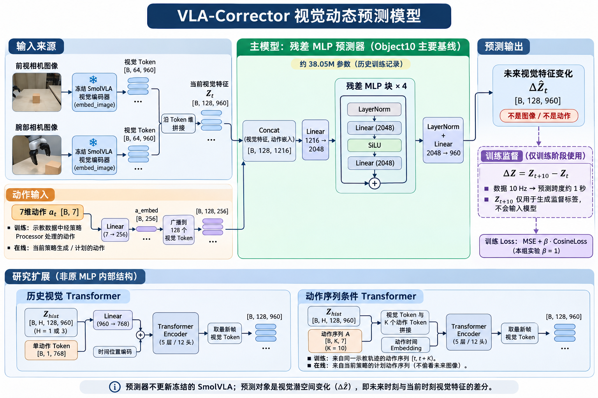

# 技术报告：SmolVLA-Corrector

  <strong>简体中文</strong> · <a href="TECHNICAL_REPORT.en.md">English</a>

[中文README](../README.md) · [English README](../README.en.md) · [复现说明](REPRODUCTION.md) · [来源与许可](../THIRD_PARTY.md)

## 摘要

针对视觉—语言—动作模型（Vision-Language-Action，VLA）在执行较长动作块（Action Chunk）期间难以及时响应环境状态变化的问题，本项目以 SmolVLA 为基础策略，在 LIBERO 环境中复现 VLA-Corrector 的视觉动态预测、潜空间视觉监测（LVM）和在线梯度引导（OGG）机制，并研究其闭环效果、计算开销与跨任务适用性。在 Object10 的 60 组配对条件下，MLP-LVM 成功 55 次（91.7%），较固定执行窗口 H20（51/60）和 H50（44/60）分别提高 **6.7 与 18.3 个百分点**；OGG 未在该组实验中带来额外成功回合。但在 Spatial、Goal、Long 三个任务套件的主要对照中，LVM 并未保持相对于 H20 的优势。本项目还比较了残差 MLP、历史视觉 Transformer 与多步动作条件 Transformer 等预测器配置，分析离线预测能力与闭环性能之间的关系。结果表明，事件触发重规划在特定任务条件下可能带来收益，但不能据此推断其具有普遍的跨任务优势。

## 1. 研究背景与问题定义

### 1.1 Action Chunk 的执行局限

VLA 策略通常根据当前图像、语言指令和机器人状态生成未来一段动作序列。设一次生成的动作长度为 \(C\)，固定策略实际执行的动作前缀长度为 \(H\)，一般满足 \(H\leq C\)。在这 \(H\) 步内，机器人可以持续执行缓存动作，而无需每一步都重新调用较大的 VLA 模型。这有助于减少策略推理调用，也能保持动作在短时间内的连续性。

然而，**生成动作时观察到的环境不一定能代表后续执行过程中的真实环境**。例如，机械臂未能成功抓取目标物体，或物体在接触后发生滑移，旧动作块中后续的移动与放置指令便可能失去适用性。如果仍执行这些动作，状态偏差可能进一步累积。将固定窗口 \(H\) 缩短能够提高观测与重规划频率，但同时增加 VLA 调用次数；固定的 \(H\) 也无法根据不同任务阶段的执行状态动态调整。

[查看 H50 抓取失败的仿真片段](../media/showcase/H50_failure.mp4)。在该示例中，机械臂未能完成抓取，却仍按已生成的动作序列继续运动。该视频用于说明问题情形，**不代表随机抽取的完整实验结果，也不能单独证明任何方法的优劣**。

### 1.2 研究目标与评价维度

VLA-Corrector 的思路是在冻结基础 VLA 策略的前提下，引入外部视觉动态预测器，并在动作执行过程中比较**预测的视觉变化**与**随后实际观测的变化**。如果偏离达到触发条件，系统提前中断当前动作队列并请求重新规划；必要时利用预测器梯度影响恢复动作的生成。

本项目重点考察四个问题：一是 LVM 相较 H50、H20 等固定执行窗口能否提高闭环成功率；二是 OGG 能否在 LVM 之外带来额外收益；三是历史视觉信息与多动作条件能否改善预测及在线表现；四是这些收益是否能够跨任务保持，并且是否值得新增的监测计算开销。

这里需要区分不同层次的指标：**离线预测损失**衡量对视觉变化的拟合，**监测与触发记录**反映系统何时判断需要重新规划，**任务成功率**评价完整操作结果，而**策略调用次数和墙钟耗时**衡量计算代价。一个指标改善不意味着其他指标必然同步改善。

## 2. 方法设计与实现

### 2.1 整体架构

VLA-Corrector 的核心检测与引导思想来自原始 [VLA-Corrector](https://github.com/ZJU-OmniAI/vla-corrector) 研究。本项目基于固定版本源码对接 SmolVLA 与 LIBERO 环境，并开展预测器结构扩展和闭环对照实验；上游来源、版本与许可见[第三方说明](../THIRD_PARTY.md)。

从职责上看，系统可分为以下三个模块：

1. **视觉动态预测（Corrector）：** 根据冻结 SmolVLA 提取的视觉 Token 及动作条件，预测固定时间跨度后的视觉特征变化。
2. **潜空间视觉监测（LVM）：** 在预测到期且对应观测已到达时，计算预测变化与实际变化的偏离，并结合历史评分及阈值状态机决定是否提前中断。
3. **在线梯度引导（OGG）：** 当 LVM 决定中断后，仅在随后一次恢复重规划中，通过冻结预测器对候选动作的输入梯度引导动作生成。

基础 SmolVLA 仍负责生成和执行动作，Corrector 不替代 VLA 本体。**LVM 负责“是否重规划”，OGG 负责“重规划时如何引导候选动作”**；二者具有不同的输入、损失和调用时机。

### 2.2 视觉动态预测模型

#### 2.2.1 输入来源与预测目标

预测器使用冻结 SmolVLA 的视觉编码路径。前视相机和腕部相机经过图像编码器及 Connector 等处理，所得视觉 Token 沿序列维拼接。在 Object10 使用的两路相机配置下，当前视觉特征为

\[
Z_t\in\mathbb R^{B\times128\times960},
\]

其中 \(B\) 是批次大小；128 是两路相机的 Token 总数；960 是每个 Token 的特征维度。这不是 RGB 图像，也不是机器人关节状态。

原始单动作预测器还接收一个经过策略预处理器转换的 7 维动作 \(a_t\in\mathbb R^{B\times7}\)。训练时动作来自示教轨迹，在线时来自策略当前规划并即将执行的动作。模型学习

\[
\widehat{\Delta Z}_{t\rightarrow t+k}=f_\theta(Z_t,a_t),\qquad
\Delta Z_{t\rightarrow t+k}=Z_{t+k}-Z_t.
\]

输出与 \(Z_t\) 形状相同，但语义是**未来视觉特征变化量**，而不是未来图像或动作。训练数据中的 \(Z_{t+k}\) 只用于构建监督目标，并不作为输入提供给预测器。

主要 Object10 训练使用 10 Hz 示教数据和 \(k=10\)，因此预测跨度约为 **1 秒**。在线 LIBERO 环境以 20 Hz 控制时，相同物理跨度应对应 **20 个环境控制步**。训练与监测必须按时间跨度对齐，不能简单将不同采样频率下的“10步”视为等价。

#### 2.2.2 残差 MLP 基线

原始 MLP 将 7 维动作映射为 256 维动作嵌入，并广播到全部视觉 Token；每个 Token 与 960 维视觉特征拼接后，得到 1,216 维输入。随后依次经过输入投影、**4 个宽度为 2,048 的残差 MLP 块**、归一化和输出投影，得到与输入视觉特征同形状的预测变化量。实际 Object10 MLP 训练记录对应 **38,052,800 个参数**，可近似表述为 38.05M。

这里容易产生的误解是：模型只有一个动作输入，却监督一秒后的变化。它并不是严格地模拟未来所有动作，而是在示教数据分布下学习**当前视觉条件和动作与后续视觉演化之间的统计关系**。这也意味着，当后续动作轨迹发生较大变化时，预测结果不一定仍适用。

正式训练使用 MSE 与余弦方向损失的组合：

\[
\mathcal L_{\mathrm{pred}}=
\operatorname{MSE}(\widehat{\Delta Z},\Delta Z)
+\beta\Bigl(1-\cos\bigl(\operatorname{vec}(\widehat{\Delta Z}),\operatorname{vec}(\Delta Z)\bigr)\Bigr).
\]

其中 Object10 记录的 \(\beta=1\)，损失在批次上取平均。MSE 约束变化量的数值差异，余弦项衡量视觉变化向量的方向一致性。此处是**离线训练预测器的监督损失**，与第2.4节的在线OGG引导损失不同。

#### 2.2.3 模型扩展：历史观测与多动作条件

本项目在 MLP 基线之外进一步比较两类预测器结构。

**历史视觉 Transformer**：模型可接收单帧或最近三帧视觉 Token，并通过时间嵌入、线性投影和 Transformer Encoder 建模历史观测之间的关系。实验配置使用 768 维隐藏层、12 个注意力头和 5 层 Encoder；最后从最新一帧对应的 Token 输出**一份**未来视觉特征变化量。多帧历史是输入条件，不代表模型预测了多帧未来图像。

**多动作条件 Transformer**：在历史视觉信息之外，额外接收预测跨度内的多个动作。本项目的探索配置采用 10 个按示教采样间隔排列的动作，分别编码动作值与时间位置，再与视觉 Token 共同输入 Transformer。训练时这些动作来自示教中**实际执行**的动作；在线时只能使用当前策略生成的**计划动作**，不能提前看到未来实际执行结果。

两类动作条件存在分布差异：规划动作可能被中断或替换，且当前动作队列未必覆盖所需的整个时间跨度。在线实现会在条件不足时跳过预测，并在规划失效时取消依赖旧动作计划的待评估预测。多动作条件是否更优，需要同时比较其离线损失与真实闭环结果，不能仅根据输入信息更多就作出判断。

对应实现：[预测器结构](../implementation/corrector_models.py)、[数据提取与预处理](../implementation/corrector_data_workbench.py)、[模型训练](../implementation/corrector_train.py)。

### 2.3 在线监测模块（LVM）

LVM 用于判断执行过程是否**持续偏离此前预测的视觉演化**，从而决定是否丢弃剩余动作并提前重新规划。偏离分数并不是一个直接判断抓取成功或失败的分类器。

#### 2.3.1 预测登记与到期评分

控制步 \(t\) 时，系统保存当前视觉特征 \(Z_t\)、预测变化量 \(\widehat{\Delta Z}_{t\rightarrow t+k}\) 及到期时刻 \(t+k\)，将其加入待评估预测队列。只有到期观测真正到达后，才能计算

\[
\Delta Z^{\mathrm{obs}}_{t\rightarrow t+k}=Z_{t+k}-Z_t,
\]

以及视觉偏离分数

\[
E_{t+k}=1-\cos\Bigl(
\operatorname{vec}(\widehat{\Delta Z}_{t\rightarrow t+k}),
\operatorname{vec}(\Delta Z^{\mathrm{obs}}_{t\rightarrow t+k})\Bigr).
\]

因此，**预测尚未到期、缺少必要历史或缺少有效动作条件的时段不能被当作已经评分**。较大的 \(E\) 表示预测变化与实际变化方向较不一致，但单个分数不能直接证明机器人发生操作失败。

#### 2.3.2 Bootstrap、动态阈值与触发条件

本项目的正式在线适配使用固定上游的 \`RobustThresholdState\` 和 \`robust_threshold_step\` 实现状态机，其核心过程为：

1. **平滑与Bootstrap校准。** 对有效评分应用指数加权移动平均（EWMA）；在 Bootstrap 阶段积累校准样本。当前上游默认需要 15 个有效评分，校准完成前不产生正常的自动触发。
2. **鲁棒双阈值。** 对最近的历史评分计算中位数与中位绝对偏差（MAD），构造触发阈值 \(T_{\mathrm{on}}\) 和释放阈值 \(T_{\mathrm{off}}\)，并设置基础噪声下限。高、低阈值使持续偏离与恢复到安全状态采用不同判据。
3. **持续超阈与突变检测。** 连续超过高阈值条件的评分增加计数；达到设定耐心值后可以触发。同时保留满足额外条件的突变触发路径。默认的持续超阈耐心值是 **5 次有效评分**，并不是5个环境控制步。
4. **报警保持与可选冷却。** 状态机还维护 \`alert_active\`、连续低于释放阈值的计数及可配置冷却。低分持续满足重置条件后解除报警；冷却期间普通重触发受到限制，是否允许更强偏离重新触发取决于相应配置。

上述数字描述的是固定上游状态机的默认值，具体实验配置仍应对照保存的运行协议。**报警状态、阈值变化与实际中断事件不是同一件事**，也不能把所有Bootstrap期间的控制步都简单视作有效评分。

#### 2.3.3 中断及后续动作处理

当前在线适配支持三种监测相关模式：\`monitor\` 只记录评分、不打断动作；\`lvm\` 在触发条件成立时清空动作队列并重新调用基础策略；\`ogg\` 在同样的中断之后，为紧接着的一次恢复重规划额外开启梯度引导。

中断时清空的是**尚未执行的缓存动作**，而不是整个监测状态；如果当前预测依赖随后被废弃的动作计划，还需要同步取消这些预测。当前实现通过 \`select_action()\` 同步执行视觉特征提取、预测和评分，因此监测本身会增加墙钟开销；调用VLA次数减少不等于整体执行更快。

源码：[在线运行适配](../implementation/corrector_online_runtime.py)、[偏离评分练习与核心计算](../implementation/corrector_online_practice.py)。

### 2.4 动作引导模块（OGG）

OGG 只作用于**LVM触发中断后紧接着的一次恢复重规划**。它与 LVM 的分工是：LVM 判断当前动作是否应提前停止；OGG 尝试影响下一次候选动作的生成方向。两者并不在每个控制步持续共同优化。

当一份预测到期时，系统已经得到预测变化 \(\widehat{\Delta Z}\) 与实测变化 \(\Delta Z^{\mathrm{obs}}\)。在线实现将二者之差构造为潜空间修正目标：

\[
\Delta Z_{\mathrm{target}}
=\widehat{\Delta Z}-\Delta Z^{\mathrm{obs}}.
\]

该目标来自当前已经观察到的偏离，并非读取未来真值，也不能直接理解为机器人应到达的精确目标位姿。

在 SmolVLA 的 Flow Matching 采样过程中，设当前去噪状态为 \(x_\tau\)、速度场为 \(v_\tau\)、Flow Matching 时间变量为 \(\tau\)。实现首先构造候选干净动作估计

\[
\widehat{x}_0=x_\tau-\tau v_\tau.
\]

单动作预测器选取该动作块第一个位置的有效7维动作，与当前视觉特征一起送入冻结的 Corrector，得到候选动作对应的预测视觉变化 \(\widehat{\Delta Z}_{\mathrm{cand}}\)。随后计算

\[
\mathcal L_{\mathrm{OGG}}=
1-\cos\Bigl(
\operatorname{vec}(\widehat{\Delta Z}_{\mathrm{cand}}),
\operatorname{vec}(\Delta Z_{\mathrm{target}})\Bigr),
\]

并对候选速度场求梯度，通过

\[
g_\tau=\nabla_{v_\tau}\mathcal L_{\mathrm{OGG}},\qquad
v_\tau^{\mathrm{guided}}=v_\tau-\eta g_\tau
\]

调整当前去噪步骤的速度，其中 \(\eta\) 控制引导强度。调整后的速度用于继续生成动作块；代码通过 \`guidance_every\` 控制引导作用于哪些去噪步骤，**不是每个环境步都执行一次OGG**。

这一过程会临时启用**对候选输入的梯度**，但 SmolVLA 与 Corrector 均保持冻结，不更新其模型参数。多帧版本固定历史视觉上下文；多动作条件版本则允许梯度作用到新动作块中的多个选定动作位置。两者的直接求导范围不同，不应与原始单动作OGG混为一谈。

OGG能否带来恢复收益，需要独立闭环评测。本项目 Object10 的 MLP 对照中，LVM 与 OGG **均为55/60**，因此不能把相对固定H20的收益全部归因于OGG，也不能根据梯度非零或引导损失下降直接推断成功率提高。

源码：[OGG核心计算](../implementation/corrector_online_practice.py)、[多动作引导扩展](../implementation/corrector_models.py)、[在线触发与调用](../implementation/corrector_online_runtime.py)。

### 2.5 本项目的实现工作与研究扩展

本项目属于**基于公开方法的复现、系统集成与实证研究**。为避免将上游已有机制误作个人原创，主要工作与证据范围区分如下：

| 工作方向 | 本项目的实际工作及边界 | 对应实现或证据 |
| --- | --- | --- |
| Corrector及在线机制 | 基于已有研究接入预测器、LVM与OGG；阈值状态机与核心引导思想来自上游 | [原始研究](https://github.com/ZJU-OmniAI/vla-corrector)、[在线适配](../implementation/corrector_online_runtime.py) |
| 数据与预测器训练 | 使用SmolVLA双相机视觉特征与经过策略预处理的动作，完成多个预测器配置的训练、验证和Checkpoint管理 | [数据缓存](../implementation/corrector_data_workbench.py)、[训练入口](../implementation/corrector_train.py)、[训练记录](../results/object10/training_runs.csv) |
| 模型结构扩展 | 比较残差MLP、历史视觉Transformer和多动作条件Transformer，研究输入信息及架构差异；不将使用既有Transformer视作原创算法 | [模型工厂](../implementation/corrector_models.py)、[闭环记录](../results/object10/closed_loop.csv) |
| 闭环评测与复盘 | 完成固定窗口、只监测、LVM与OGG的配对实验，记录事件触发、策略调用及实际耗时 | [评测入口](../implementation/corrector_closed_loop_eval.py)、[配对统计](../results/object10/paired_comparisons.csv) |
| 跨任务与扰动检查 | 在其他LIBERO套件及选定LIBERO-Plus条件中检验收益边界，并保留负面结果 | [跨任务结果](../results/cross_suite/)、[执行窗口实验](../results/plus_horizon/) |

此外，原 [robot-lab](https://github.com/30thinkdiff/robot-lab) 研究仓库还包含多层视觉特征诊断与 RobotLab Replay 等探索性工具。这些工作与本公开展示仓库中的固定实现应分别追溯，不能默认视为已经在新仓库形成统一、可独立复现的正式方法。

有关样本选择与运行协议、完整对照数据和结果解释分别见第3、4章。**本章描述的是方法和已完成的工程工作，不把尚未验证的模型改动或原因推测写作已证实的算法改进。**

## 3. 数据与评测协议

- **基础策略：** 固定版本SmolVLA-LIBERO；模型和上游环境版本见[第三方来源](../THIRD_PARTY.md)。
- **Object10：** 10个任务、454条示教、66,984帧；5种预测器配置×3训练随机种子，共15组训练。这里展示的MLP基线为每种方法**60组同条件配对回合**。
- **跨任务评测：** 880个正式回合、220组四方法配对。主要比较为Spatial、Goal、Long三套件，每套件每方法40回合。补充初始状态和固定LIBERO-90十任务子集使用独立分母。
- **LIBERO-Plus执行窗口：** 32个筛选条件，每种固定窗口32回合、一个评测随机种子。

**【待作者完善】** 补充控制频率、Chunk生成长度和执行前缀、各任务步数上限、初始状态的记录与审计方式、训练/评测seed、Checkpoint版本、成功定义和耗时统计口径。

未核对基础策略训练任务覆盖时，不应将跨任务测试全部称作基础策略的零样本泛化。

## 4. 实验结果

### 4.1 Object10：配对闭环成功率

| 方法 | 成功回合 / 总回合 |
| --- | ---: |
| 固定执行H50 | 44/60 |
| 固定执行H20 | 51/60 |
| MLP + LVM | 55/60 |
| MLP + OGG | 55/60 |

在这些Object10配对条件下，MLP-LVM的成功回合高于固定窗口。但**OGG并没有相对LVM增加成功回合**；不能把相对于H20的全部差值归因于OGG。减少动作块生成次数也不等于端到端耗时下降，因为监测涉及额外计算。

来源：[闭环汇总](../results/object10/closed_loop.csv)和[配对对照](../results/object10/paired_comparisons.csv)。

### 4.2 跨任务结果

| 方法 | Spatial + Goal + Long：主要比较 |
| --- | ---: |
| 固定执行H50 | 81/120 |
| 固定执行H20 | 93/120 |
| MLP + LVM | 80/120 |
| MLP + OGG | 77/120 |

**【待作者完善】** 分任务套件核对配对胜负和失败类型。明确区分直接测量的结果与失败原因推断。当前主要结果只涉及指定的MLP训练模型，不能外推为所有Corrector结构都没有跨任务价值。

来源：[逐回合记录](../results/cross_suite/trials.csv)、[分方法结果](../results/cross_suite/methods.csv)。

### 4.3 监测覆盖率与动作条件

**【待作者完善】** 根据[覆盖率记录](../results/object10/monitor_coverage.csv)，分析单动作条件模型在定义的可评分步上覆盖100%、10动作条件模型约59%的差别。讨论预测取消、条件过期、历史窗口与动作队列等因素，但不能把覆盖下降直接断言为成功率降低的唯一原因。

### 4.4 执行前缀与计算代价

在选定32个LIBERO-Plus条件中，固定执行窗口成功数为：H50 **7/32**、H20 **20/32**、H10 **19/32**、H5 **15/32**、H1 **6/32**。

**【待作者完善】** 结合VLA调用次数、真实监测耗时、环境步数和墙钟时间，分析执行前缀与成本的权衡。这组筛选条件不能代表普遍最优窗口。

来源：[LIBERO-Plus实验结果](../results/plus_horizon/plus_horizon_results.csv)。

### 4.5 典型案例

**【待作者完善】** 从真实实验归档选择2—3组完整的配对视频/轨迹，包括至少一例未能纠偏或性能退化。每段视频应能对应具体任务、初始化、seed、方法、模型版本和原始文件。已挑选案例只能作为机制说明，不得当成随机样本的统计代表。

## 5. 失败分析、局限与后续假设

**【待作者完善】** 至少讨论：

- Object10正向结果未在跨任务主要比较中稳定维持；
- OGG梯度更新真实发生，不意味着最终任务成功；
- 视觉监测增加了实际墙钟开销；
- 离线预测误差与闭环成功率不是同一个指标；
- 动作条件可用性会影响监测评分覆盖；
- 多个seed与重复初始化未必构成独立物理场景；
- 已通过CPU结果复算，不等于已在干净环境完成GPU端到端复现。

对可能的原因逐条区分：**实测事实 / 基于数据的推断 / 尚未验证的假设**。

## 6. 结论

**【待作者完善｜约120—200字】** 同时呈现Object10的有条件收益、跨任务负结果与局限，再说明一个具有明确验收指标的下一步研究方向，不要将适用边界写成普遍成立。

## 附录A：公开结果复算

~~~bash
python scripts/check_source_integrity.py
python scripts/reproduce_results.py --format markdown
python -m unittest discover -s tests -v
~~~

此处命令为CPU/标准库检查，不会重新训练或运行仿真。

## 附录B：版本与来源

参见 [source_map.json](../provenance/source_map.json)、[复现说明](REPRODUCTION.md)和[第三方声明](../THIRD_PARTY.md)。

## 附录C：参考文献

- Pan et al. *VLA-Corrector: Lightweight Detect-and-Correct Inference for Adaptive Action Horizon*. NeurIPS 2026. https://github.com/ZJU-OmniAI/vla-corrector
- LeRobot / SmolVLA：https://github.com/huggingface/lerobot
- LIBERO：https://github.com/Lifelong-Robot-Learning/LIBERO

**【待作者完善】** 根据正文实际引用补充相关研究，并核实作者、正式题目、年份及版本。

---

**同步约定：** 优先维护本中文报告；后续按中文内容更新[英文技术报告](TECHNICAL_REPORT.en.md)。中英文数值或表述出现冲突时，首先以原始实验数据和实际运行协议为准。
